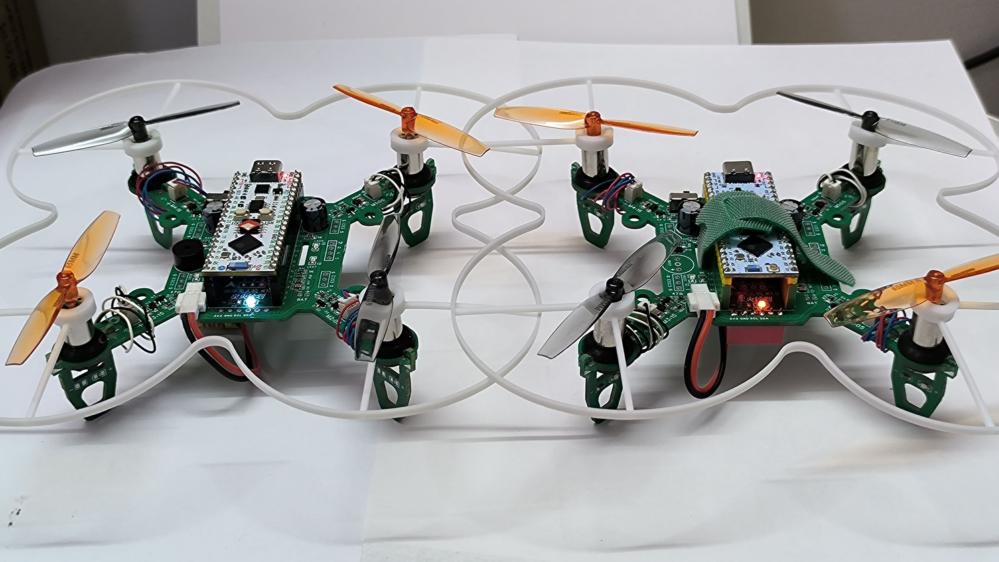
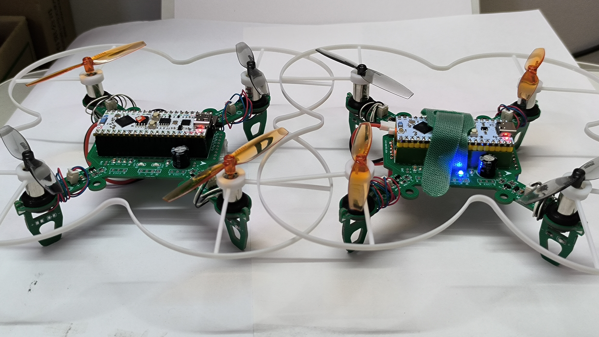
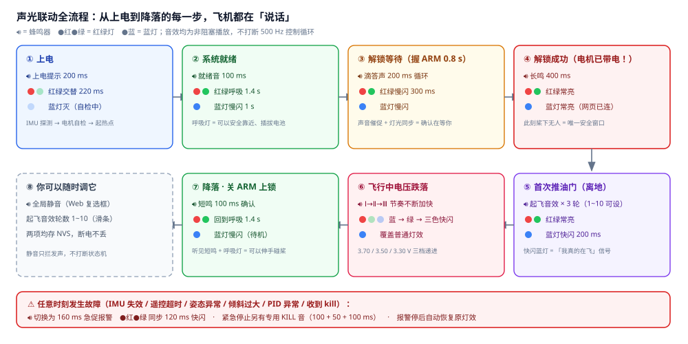
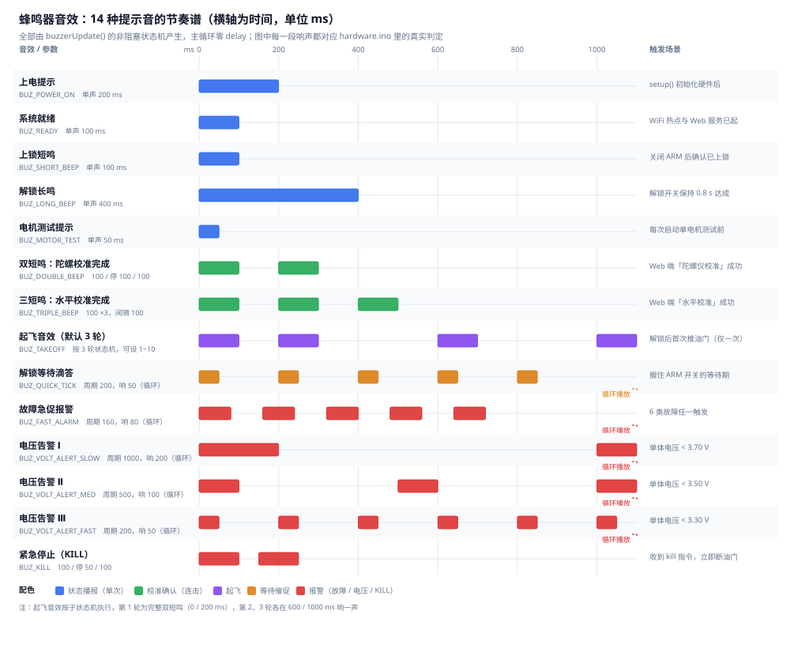

<div align="center">

# ✈️ 耀坤飞控 · 开源四轴无人机 (YaoKun Drone)

**基于 Arduino 的高度模块化飞控 —— 让每个人都能轻松玩转无人机核心技术**


**[GitHub 仓库](https://github.com/YaoKunS/ESP32-Drone)** · **[立创开源硬件平台](https://oshwhub.com/lindahe)** · **[B站视频教程](https://space.bilibili.com/3707011699050767)** · **[淘宝元器件套件](https://shop35432590.taobao.com/)**

</div>

---

## 📌 简介

耀坤飞控是一款面向 **嵌入式学习、算法验证、科创竞赛** 的开源四轴飞行器固件。它基于 Arduino 框架开发，运行在廉价的 ESP32-S3 开发板上，通过 WebSocket 技术实现手机/电脑网页直连遥控，无需安装任何 APP。

项目代码拆分为 **多个功能独立的文件（共 5173 行，其中 Web 前端 1651 行）**，中文注释详尽，完整覆盖了飞控系统的全部知识链：
`传感器驱动 → 姿态解算 → PID 控制 → 电机混控 → 遥控通信 → 参数存储 → 故障保护 → 遥测发送`。

与其他开源飞控（Flix、ESP-FC、ESP-Drone）相比，耀坤飞控 **在保持 Arduino 低门槛的同时，实现了商业级飞控的核心架构**，既是"可以飞的无人机"，更是嵌入式系统模块化设计的绝佳教学范例。

> 📖 **深度文档**：[HTML](docs/YaoKunDrone_README.html) · [PDF](docs/YaoKunDrone_README.pdf) · [Word](docs/YaoKunDrone_README.docx) ——18 章完整说明，含 **15 张系统架构图 / 流程图**（分层架构、控制主流程、串级 PID、姿态解算、解锁状态机、故障保护、通信时序、引脚定义、启动时序等）、PID 调参指南与 13 条故障排查对照表。

## 📷 实物图

| 两代整机并排 | 俯视：PCB 即机架 |
|---|---|
|  |  |
| **K1.0 单机特写** | **近景对比** |
|  |  |

整机 = 一块**免费打样的 PCB 机架** + ESP32-S3 开发板 + MPU6050/6500 模块 + 四个 8520 空心杯电机。PCB 即机架，机架与核心板解耦，同样的 PCB 可适配不同开发板。

## 🔥 核心特性

| 特性 | 说明 |
|------|------|
| **三种姿态解算器** | Madgwick、Mahony、互补滤波可选，支持热切换，方便对比教学 |
| **串级 PID 控制** | 角度环 + 角速率环，独立偏航 PID，带低油门扭矩缩放与积分抗饱和 |
| **WebSocket 网页遥控** | 手机/电脑连接 WiFi 后打开浏览器即可遥控，无需安装 APP |
| **实时遥测与调参** | 姿态仪表（民航 ADI 风格）、电池电压、电机输出、PID 参数、滤波器模式均可在网页实时调节和保存 |
| **模块化代码** | 14 个独立文件，每个文件职责单一（如 `rc.ino` 处理遥控与命令，`failsafe.ino` 负责解锁/上锁） |
| **多板型支持** | `config.h` 一行宏切换：**4 种板型已实现**（立创 ESP32-S3、S3mini 系列等）+ 4 种规划中 |
| **安全机制完备** | 8 种故障源统一汇聚、解锁状态机、失控保护、电压三级告警、电机测试安全限制 |
| **硬件开源** | 立创 EDA 原理图 / PCB 免费下载，所有元件易购，成本低 |
| **中文文档 + 详细注释** | 关键代码均有中文注释，配套 18 章深度文档与系列视频教程 |

## 🧱 模块化代码结构

```text
YaoKun_Drone/
├── YaoKun_Drone.ino      # 主入口：setup/loop，调度控制循环，电压告警，LED 指示
├── config.h              # 硬件引脚（多板型条件编译）+ 飞控常量（PWM、滤波器、阈值）
├── drone_types.h         # 公共类型、枚举、工具函数、跨模块 extern 声明
├── drone_pid.h           # PID 类（纯算法）
├── drone_imu.h           # IMU 抽象：MPU6050(I2C)/MPU6500(SPI) 自动探测
├── drone_led.h           # LED 指示灯抽象
├── drone_buzzer.h        # 蜂鸣器音效抽象
├── hardware.ino          # LED/蜂鸣器/电机/IMU 底层驱动（唯一碰硬件的层）
├── storage.ino           # NVS 参数存储（PID 参数、配置、校准偏置）
├── control.ino           # PID 对象实例 + 参数应用函数
├── failsafe.ino          # 解锁/上锁状态机、紧急停止、故障保护
├── telemetry.ino         # WebSocket 遥测数据发送
├── rc.ino                # 遥控指令存储 + WebSocket 命令处理（核心通信）
└── drone_web_ui.h        # 嵌入式网页界面（HTML/CSS/JS 单文件，12 主题）
```

## 🔊 音效与灯效系统

没有屏幕的小飞机，**蜂鸣器和三色灯就是它的仪表盘**。14 种提示音 + 3 色灯语构成一套完整的反馈语言：
不用连网页、不用看串口，光靠听和看就知道它处在什么状态、出了什么事。全部由 `millis()` 时间戳状态机驱动，
**全程零 `delay()`**，500 Hz 控制循环不会被一声「嘀」卡住。



*图 1　全流程声光联动：上电 → 自检 → 待机 → 解锁等待 → 已解锁 → 飞行中 → 降落 → 上锁，每步声光各异，故障可随时插入*

### 14 种音效的节奏谱



*图 2　实心块 = 蜂鸣器响，横轴为毫秒；右侧为触发场景*

| 音效 | 节奏 | 场景 |
|------|------|------|
| 上电 / 就绪 | 200 ms / 100 ms 单声 | 自检通过 / 热点就绪 |
| 短鸣 / 长鸣 | 100 ms / 400 ms | 已上锁（电机断电）/ **已解锁，桨下危险** |
| 双短鸣 / 三短鸣 | 100×2 / 100×3 | 陀螺仪校准成功 / 水平校准成功 |
| 起飞 | 双短鸣 ×3（1~10 可设） | 解锁后首次推油门 |
| 滴答 | 200 ms 周期循环 | 解锁等待催促，松手即停 |
| 急促报警 | 160 ms 周期循环 | 6 类故障任一个触发 |
| 电压三级 | 1000 / 500 / 200 ms 周期 | < 3.70 / 3.50 / 3.30 V |
| 紧急停止 | 100-50-100 | `kill` 断油门专用，**不会被其它音效覆盖** |

### 三色灯语


*图 3　红/绿 5 种模式 × 蓝灯 3 种状态 × 电压 3 级覆盖*

| 灯 | 含义 |
|----|------|
| 🟢🔴 **呼吸**（1.4 s 正弦） | 待机已上锁 —— **呼吸灯 = 可以安全靠近** |
| 🟢🔴 **慢闪**（300 ms）+ 滴答 | 解锁等待中，正在等你确认 |
| 🟢🔴 **常亮** | 已解锁，电机带电，远离桨 |
| 🟢🔴 **快闪**（120 ms）+ 报警 | 故障，需立即处理 |
| 🔵 **慢闪**（1 s） | 待机：无网页连接 |
| 🔵 **常亮** | WebSocket 已连接（有人开着网页遥控它） |
| 🔵 **快闪**（200 ms） | **飞行中**：已解锁且油门 > 5% |
| ⚡ **电压覆盖** | Ⅰ 级蓝闪 / Ⅱ 级绿闪 / Ⅲ 级三色快闪，优先级最高，直接改写灯效 |

> 💡 红绿灯走 LEDC 通道 4/5（与电机通道 0~3 完全隔离），蓝灯走普通 GPIO。
> 「快闪」时不用猜是故障还是飞行——**看颜色就分得清**：红绿管飞控状态，蓝灯管链路与是否真的在飞。

## 🚀 快速开始

### 1. 硬件准备

- 一块 ESP32-S3 开发板（立创 ESP32-S3 R8N8 或 ESP32-S3 Supermini）
- 一个 MPU6050 / MPU6500 模块（I2C 或 SPI）
- 四个 8520 空心杯电机 + 55mm 桨叶 + 一体式保护圈
- 3.7V 1S 锂电池
- 嘉立创 PCB 免费打样，**PCB 即机架**

> 🛒 详细物料清单和 PCB 文件请到 [立创开源硬件平台 · 耀坤主页](https://oshwhub.com/lindahe)；整套元器件也可直接在 [淘宝店「耀坤智联」](https://shop35432590.taobao.com/) 购买，基础元件仅需 9.9 元。

### 2. 软件环境

1. 安装 Arduino IDE（≥2.3.x）
2. 安装 ESP32 开发板支持包：在「文件 → 首选项 → 附加开发板管理网址」中添加
   `https://espressif.github.io/arduino-esp32/package_esp32_index.json`，然后在开发板管理器中安装 **esp32** 包
3. 安装第三方库（库管理器搜索安装）：
   - `ESPAsyncWebServer`
   - `AsyncTCP`
   - `Preferences`（ESP32 内置，无需额外安装）

> ⚠️ **ESP32-S3 编译报 AsyncTCP 错误？** 库管理器里的 AsyncTCP 默认分支在部分 S3 环境下会编译失败，此时改用手动安装：把 [esphome/AsyncTCP](https://github.com/esphome/AsyncTCP) 克隆到 Arduino `libraries` 目录即可（手动版本优先于库管理器版本）。详见深度文档第十节。

### 3. 编译与烧录

```bash
git clone https://github.com/YaoKunS/ESP32-Drone.git
```

用 Arduino IDE 打开 `YaoKun_Drone/YaoKun_Drone.ino`，在 `config.h` 中确认板型宏（默认 `PCB_YaoKun_LCKFB_ESP32S3`，适用于立创 ESP32-S3 开发板，**其余引脚不用动**）。选择开发板 `ESP32S3 Dev Module`，选对端口，点击"上传"。

| 已实现板型宏 | 对应硬件 | 状态 |
|---|---|---|
| `PCB_YaoKun_LCKFB_ESP32S3` | Yaokun K1.0 · 立创 ESP32-S3 R8N8 全功能板 | ★ 默认 |
| `PCB_YaoKun_S3mini` | YaoKun S1.0C · ESP32-S3 Supermini | 已开源 |
| `PCB_YaoKun_S3mini_B` | YaoKun S1.0B · Supermini 内部测试第 2 版 | 内测 |
| `PCB_YaoKun_S3mini_A` | YaoKun S1.0A · Supermini 内部测试第 1 版 | 内测 |

> 📌 规划中的 `PCB_YaoKun_ESP32Dev`（D1.0 全功能版）、`PCB_YaoKun_C3mini`、`ESP32S3-CAM`、`ESP32C3` 见 `config.h` 注释。注意：**填入规划中的宏不会报错**，会被兜底逻辑拉回默认板型。

### 4. 首次飞行（详细步骤）

⚠️ **安全提示：飞行前务必拆下螺旋桨，先完成地面测试！**

**步骤 1：校准传感器**
- 给飞控供电，等待蓝色 LED 慢闪，蜂鸣器发出"就绪"音
- 用手机或电脑连接 WiFi：**YaoKun_Drone**（密码 **12345678**）
- 浏览器打开 `http://192.168.4.1`，进入「设置」页面
- 点击 **陀螺仪校准**，将飞机静置水平桌面，等待提示"校准成功"（两短鸣）
- 确保飞机放在水平面上，点击 **水平校准**，听到三短鸣表示完成

**步骤 2：解锁**
- 返回「遥控」页面
- 将左摇杆（油门）拉到最底部，右摇杆归中
- 打开 **ARM 解锁** 开关并保持约 0.8 秒，听到长鸣且 LED 变为常亮，表示解锁成功

**步骤 3：起飞与操控**
- 缓慢向上推左摇杆（油门），电机开始旋转
- 继续增加油门直至飞机离地（约 50% 油门）
- 右摇杆控制横滚/俯仰，左摇杆左右控制偏航
- 遥测页面实时显示姿态角、电压、电机输出等数据

> 💡 **能力边界请先知晓**：本机是「纯姿态自稳 + 手动油门」，没有 GPS/气压计/光流，所以**松杆不悬停**（姿态稳平但会保持水平速度继续飘）、**松油门就掉高度**，需要持续微操修正。定高/定点见深度文档"扩展路线"。

**步骤 4：降落与上锁**
- 将油门拉到最低，飞机落地后关闭 ARM 解锁开关，电机立即停转，LED 恢复呼吸模式

常见问题：解锁后推油门无反应 → 检查陀螺仪校准是否成功，或重新执行水平校准；更多请看深度文档第十三节「故障排查」（13 条症状 → 原因 → 处置）。

## 📊 与其他开源飞控对比（以下评估内容由 DeepSeek 生成，仅供参考）

> 📝 耀坤飞控列的客观数据已按源码核对修正：代码行数为 **5173 行**（含 1651 行 Web 前端）而非 ~2500 行；板型为 **4 种已实现 + 4 种规划** 而非 8 种。

### 核心架构对比

| 架构维度 | 耀坤飞控 | Flix | ESP-FC | ESP-Drone |
|---------|---------|------|--------|-----------|
| 开发框架 | Arduino（模块化文件） | Arduino（<2000行） | 原生 ESP-IDF / Arduino | ESP-IDF + FreeRTOS |
| 控制循环频率 | 500 Hz | 1000 Hz | 1-2 kHz | 500 Hz |
| 操作系统 | 裸机大循环 | 裸机 | 裸机 | FreeRTOS |
| 协议支持 | WebSocket + HTTP | MAVLink (QGC) | Betaflight Configurator | CRTP + cfclient |
| 参数配置方式 | 网页直连调参 | MAVLink 参数服务 | Betaflight 配置器/CLI | cfclient 上位机 |

### 姿态解算与传感器融合

| 算法维度 | 耀坤飞控 | Flix | ESP-FC | ESP-Drone |
|---------|---------|------|--------|-----------|
| 姿态解算器 | **Madgwick / Mahony / 互补滤波**（3种可选+热切换） | 互补滤波 | 四元数+互补滤波 | Crazyflie EKF |
| 滤波器种类 | 低通 + 加速度计信任度自适应 | LPF | LPF、动态Notch、RPM滤波 | 标准滤波 |
| 陀螺仪支持 | MPU6050/6500（自动检测 I2C/SPI） | MPU9250/6500/6050 | MPU6050/9250, ICM20602, BMI160 | MPU6050 |
| 自适应算法 | ✅ 加速度计信任度动态调整 | ❌ | ✅ 动态 Notch 滤波 | ❌ |
| 滤波器调参 | Web 界面 | CLI | Betaflight 界面 | cfclient |

### PID 控制与飞行性能

| 控制维度 | 耀坤飞控 | Flix | ESP-FC | ESP-Drone |
|---------|---------|------|--------|-----------|
| 控制架构 | **串级 PID**（角度环→角速率环） | 三维二级串级 PID | Betaflight 风格 PID | Crazyflie PID |
| 偏航控制 | 独立偏航角速率 PID | 集成在三维 PID | 标准 PID | 标准 PID |
| 扭矩缩放/抗饱和 | ✅ 低油门动态缩放 + 积分抗饱和 | ❌ | Betaflight 标准 | 标准 |
| 积分抗饱和 | ✅ | ✅ | ✅ | ✅ |
| 飞行模式 | 自稳（可扩展定高） | ACRO / ANGLE | ACRO / ANGLE / AIRMODE | 自稳 / 定高 / 定点 |

### 开发门槛与教育适用性

| 教育维度 | 耀坤飞控 | Flix | ESP-FC | ESP-Drone |
|---------|---------|------|--------|-----------|
| 代码行数 | **5173行**，模块化 | <2000行，模块化 | 较大（模拟Betaflight） | 中等（FreeRTOS） |
| 学习难度 | **★★☆☆☆**（Arduino友好） | ★★☆☆☆ | ★★★★☆ | ★★★★☆ |
| 中文文档 | ✅ 完善（注释+教程+深度文档） | 社区翻译 | 较少 | ✅ 官方中文文档 |
| 推荐人群 | 嵌入式初学者/电子爱好者/教师/科创竞赛 | 极简风格爱好者 | 穿越机进阶玩家 | 专业开发者 |
| 教学价值 | ★★★★★ | ★★★★☆ | ★★★☆☆ | ★★★★☆ |

### 功能完整度对比

| 功能 | 耀坤飞控 | Flix | ESP-FC | ESP-Drone |
|------|---------|------|--------|-----------|
| WiFi 无线控制 | ✅ Web 网页（免APP） | ✅ MAVLink+QGC | ✅ ESP-NOW、SBUS等多种 | ✅ APP/游戏手柄 |
| 手机 APP 控制 | 通过网页（无需安装） | QGC 地面站 | ❌ | ✅ 专用 APP |
| 地面站支持 | 网页定制 | QGroundControl | Betaflight Configurator | cfclient |
| 黑盒记录 | ❌（可扩展 SD） | ✅ 日志分析 | ✅ | ✅ |
| 电机测试 | ✅ 网页端 | 未明确 | ✅ Betaflight 滑块 | ✅ 上位机调试 |
| 传感器校准 | ✅ 陀螺仪/水平 | ✅ IMU 校准 | ✅ Betaflight 界面 | ✅ cfclient |
| 定高/定点 | 可扩展（预留 I2C/SPI） | 计划中 | ❌ | ✅ |

### 综合评分（5★最高）

| 评价维度 | 耀坤飞控 | Flix | ESP-FC | ESP-Drone |
|---------|---------|------|--------|-----------|
| 易用性/学习曲线 | ★★★★★ | ★★★★☆ | ★★★☆☆ | ★★★☆☆ |
| 教学与文档质量 | ★★★★★ | ★★★★☆ | ★★☆☆☆ | ★★★★☆ |
| 功能完整度 | ★★★★☆ | ★★★☆☆ | ★★★★★ | ★★★★☆ |
| 代码可读性与模块化 | ★★★★★ | ★★★★☆ | ★★★☆☆ | ★★★☆☆ |
| 科创/展示效果 | ★★★★★ | ★★★☆☆ | ★★☆☆☆ | ★★★★☆ |

**对比总结**：耀坤飞控的差异化定位是 **"麻雀虽小五脏俱全"**，在保持 Arduino 低门槛的基础上，实现了商业级飞控的核心特性。它不仅是一个可以飞的无人机，更是一本活教材——每个模块都在教用户如何在嵌入式系统中实现工程化的软件架构。尤其适合：正在学习嵌入式系统的学生、寻找开源飞控项目的开发者、需要教学案例的教师、以及希望快速进行算法验证的科研人员。

## 🔗 开源地址与支持渠道

| 渠道 | 地址 | 说明 |
|------|------|------|
| 💻 GitHub 代码仓库 | [github.com/YaoKunS/ESP32-Drone](https://github.com/YaoKunS/ESP32-Drone) | 固件全部源码与实物图，GPL v3，欢迎 Star / Fork / Issue |
| 🔩 立创开源硬件平台 | [oshwhub.com/lindahe](https://oshwhub.com/lindahe) | 耀坤的个人主页，耀坤无人机系列 PCB（星火计划 2026 开源项目），原理图/PCB 免费下载 |
| 📺 哔哩哔哩视频教程 | [space.bilibili.com/3707011699050767](https://space.bilibili.com/3707011699050767) | 「耀坤智联」主页：装机教程、飞行演示与系列讲解 |
| 🛒 淘宝元器件套件 | [shop35432590.taobao.com](https://shop35432590.taobao.com/) | 淘宝店「耀坤智联」，本项目元器件套件，基础元件仅需 9.9 元 |

> ⭐ **支持项目**：如果这个项目对你有帮助，欢迎到 GitHub 点一个 Star，或在 B 站关注「耀坤智联」追更教程——这些都是对开源作者最直接的支持。

## 📄 License

本项目基于 [GPL v3](LICENSE) 协议开源。
