<div align="center">

# ✈️ 耀坤飞控 · YaoKunDrone

**基于 ESP32-S3 的纯姿态自稳四轴飞控 —— 浏览器直连遥控，全参数在线可调**


**简体中文** · [**English**](README_EN.md)

</div>

---

> 📖 **这是一份完整技术文档**（18 章），不是普通 README 摘要。与 `Docs/YaoKunDrone_README.html`  
> / `.pdf` / `.docx` 内容完全一致：网页版带排版与目录高亮适合阅读，本 Markdown 版适合在仓库内检索与引用。

---

## 目录

- [一、项目简介](#一项目简介)　——　它是什么，能做什么
- [二、功能特征](#二功能特征)　——　14 项能力清单
- [三、系统架构](#三系统架构)　——　五层分层与模块依赖
- [四、控制主流程](#四控制主流程)　——　500 Hz 流水线与 6 道安全闸门
- [五、控制算法详解](#五控制算法详解)　——　串级双环 PID 与混控
- [六、姿态解算](#六姿态解算)　——　三滤波器与自适应信任度
- [七、安全机制](#七安全机制)　——　8 种故障源与解锁状态机
- [八、通信与 Web 遥控](#八通信与-web-遥控)　——　协议时序与界面结构
- [九、音效与灯效系统](#九音效与灯效系统)　——　14 种音效谱与三色灯语
- [十、硬件与引脚定义](#十硬件与引脚定义)　——　板型切换与接线
- [十一、编译与烧录](#十一编译与烧录)　——　环境、库、步骤、常见问题
- [十二、使用方法](#十二使用方法)　——　首次上电到飞行的完整流程
- [十三、PID 调参指南](#十三pid-调参指南)　——　PID 与限值整定
- [十四、故障排查](#十四故障排查)　——　症状 → 原因 → 处置
- [十五、设计取舍与已知边界](#十五设计取舍与已知边界)　——　诚实的局限性说明
- [十六、扩展路线](#十六扩展路线)　——　预留引脚指向的下一步
- [十七、与同类开源飞控对比](#十七与同类开源飞控对比)　——　vs Flix / ESP-FC / ESP-Drone
- [十八、开源地址与支持渠道](#十八开源地址与支持渠道)　——　GitHub / 立创 / B站 / 淘宝

---

## 一、项目简介

**耀坤飞控（YaoKunDrone）**&#x662F;一套完全自主研发的、基于 ESP32-S3 微控制器的四轴无人机飞控固件。它运行在 Arduino 框架上，把姿态解算、串级 PID 控制、安全保护、遥测上报和浏览器遥控界面整合进 **5173 行**可读性很强的 C/C++ 代码中，无需图形化上位机工具、无需专用地面站，一台手机连上飞机热点打开网页就能操控、调参、看状态。

这个项目的出发点不是做一个「能飞的玩具」，而是做一套**能被完整读懂、能被放心修改的开源飞控教学与实践平台**。因此代码里的每一个常数都有出处注释，每一处非直觉的设计都写清了「为什么这么写」和「不这么写会怎样」——它同时也是一份可运行的中文飞控教材。

> 📌 **当前固件版本 v1.1（2026-10-23）**，相对 v1.0 的三项变更（均由真机试飞问题驱动，详见对应章节）：① 关闭芯片欠压复位（brownout）——修复地面临界油门必重启的问题，见第七节；② 偏航环加入积分 Ki=0.005——消除电机/桨扭矩不对称导致的匀速自旋，见 5.5 节；③ 偏航扭矩符号适配（`kYawTorqueSign`）——适配实测电机布局，修复起飞加速自旋，见 5.3 节。

### 1.1 实物一览

整机由一块**免费打样的 PCB 机架** + ESP32-S3 开发板 + MPU6050/6500 模块 + 四个 8520 空心杯电机组成，飞控热点是 `YaoKun_Drone`。以下实物图来自开源仓库 [github.com/YaoKunS/ESP32-Drone](https://github.com/YaoKunS/ESP32-Drone)：


*图 1-1　两代整机并排：两机均为立创 ESP32-S3 全功能版*

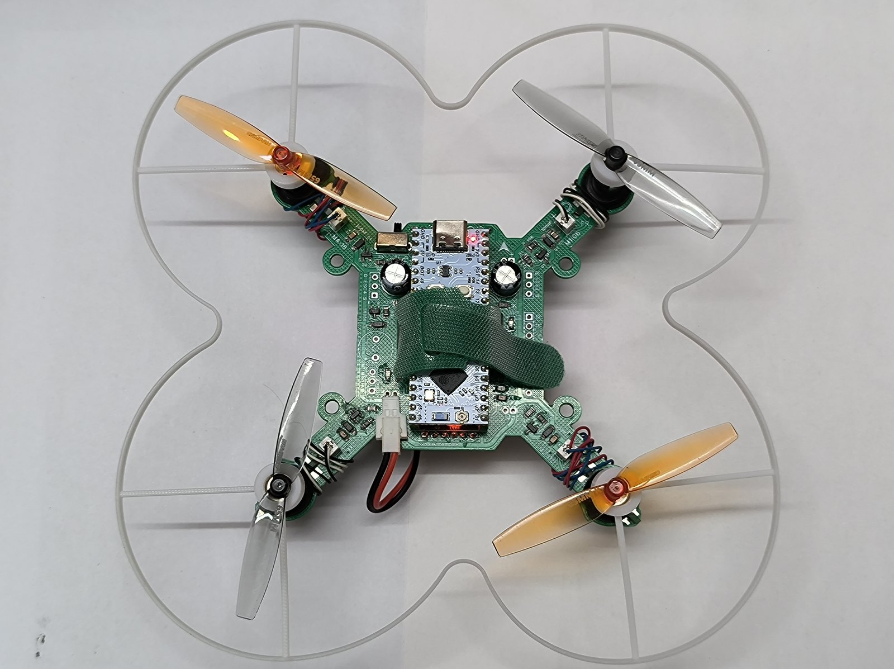

*图 1-2　俯视图：PCB 即机架——X 型四臂、8520 空心杯电机、65 mm 桨与可拆卸保护圈*

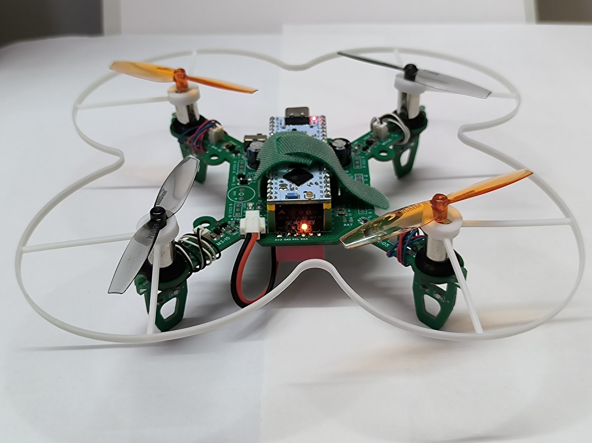

*图 1-3　K1.0 单机特写：立创 ESP32-S3 R8N8 核心板直插 PCB 插座，尼龙扎带固定 1S 电池*


*图 1-4　两机近景对比：均为立创 ESP32-S3 全功能版，共用同一套 PCB 机架（桨叶配色不同便于区分）*

### 1.2 飞行能力定位（请先读这一段）

> ⚠️ **本机是「纯姿态自稳 + 手动油门」飞控，没有任何位置或速度传感器。**  
>   
> 机身上只有一个六轴 IMU，没有 GPS、气压计、激光测距、光流、磁罗盘。所以：

| 能力      | 说明                                               |
| ------- | ------------------------------------------------ |
| **能做**  | 姿态自稳——松开摇杆时机体会自己把水平面稳住；横滚、俯仰、偏航三轴可控；油门手动。        |
| **不能做** | 悬停定点。松杆时姿态被稳住，但**会保持既有水平速度继续飘**；**松油门就掉高度**。     |
| **因此**  | 飞行时需要持续微操修正，属于「运动相机式的手动飞行」体验，而非消费级无刷机的 GPS 定点体验。 |

> 💡 想获得真正的定点悬停能力，需要接入激光测距（VL53L1X）+ 光流（PMW3901）——本工程已为此预留了 SPI 与第二组 I2C 引脚，详见 [第十六节 扩展路线](#十六扩展路线)。

### 1.3 目标平台与开源信息

| 项目    | 内容                                                                                                          |
| ----- | ----------------------------------------------------------------------------------------------------------- |
| 主控平台  | ESP32-S3（默认适配立创 ESP32-S3 R8N8 开发板，同时兼容 ESP32-S3 Supermini 系列）                                               |
| 姿态传感器 | MPU6050（I2C）或 MPU6500（SPI），开机自动探测，无需手动配置                                                                    |
| 动力输出  | 四路 LEDC 硬件 PWM，20 kHz / 10-bit                                                                              |
| 通信方式  | WiFi SoftAP + WebSocket（飞控自建热点，无需路由器）                                                                       |
| 代码仓库  | [github.com/YaoKunS/ESP32-Drone](https://github.com/YaoKunS/ESP32-Drone)（GPL v3 开源，含全部源码与实物图）               |
| 开源硬件  | [嘉立创开源硬件平台 · 耀坤的主页（oshwhub.com/lindahe）](https://oshwhub.com/lindahe)——耀坤无人机（星火计划 2026 开源项目），原理图 / PCB 免费下载 |
| 元器件套件 | 淘宝店「耀坤智联」[shop35432590.taobao.com](https://shop35432590.taobao.com/)，基础元件仅需 9.9 元                           |
| 视频教程  | 哔哩哔哩 B 站「耀坤智联」[space.bilibili.com/3707011699050767](https://space.bilibili.com/3707011699050767)            |

## 二、功能特征

### 2.1 飞行控制

- **串级双环控制**：横滚与俯仰采用「角度外环 + 角速率内环」串级结构，偏航为单环角速率控制。500 Hz 固定周期调度。
- **X 型混控**：四电机分处机臂对角，单电机故障时仍保留剩余推力与部分控制能力，容错优于 H 型。
- **低油门扭矩补偿**：按油门线性缩放控制量，抵消电调线性区对操控性的侵蚀，悬停时仍能精细微调。
- **积分抗饱和**：PID 输出触顶时积分项按 0.99 系数缓慢衰减，防止限幅期间积分失控，恢复后姿态猛甩。

### 2.2 姿态估计

- **三套解算器可运行时切换**：Madgwick 梯度下降、Mahony（Betaflight 式 PI 修正 DCM）、互补滤波，默认 Mahony。
- **加速度计信任度自适应**：实时计算 `|a|` 偏离 1g 的程度得到信任度，据此动态调整 Madgwick 的 β 或互补滤波的 α。剧烈机动或自由落体时滤波器自动退化为纯陀螺积分，不会被错误的重力方向带跑。
- **三种 IMU 自动识别**：MPU6050（I2C，WHO_AM_I = 0x68/0x70）与 MPU6500（SPI，WHO_AM_I = 0x70）开机自检识别。
- **软件轴重映射**：`SwapXY / FlipX / FlipY / FlipZ` 四个开关适配不同模块的贴装朝向，换 IMU 不用改驱动。
- **自动水平校准**：上锁状态下检测到静止满 400 ms，自动以加速度计读数重置水平参考并同步给三个解算器。

### 2.3 安全保护

- **8 种故障保护原因**统一编码（IMU 失效 / dt 超限 / 倾斜超限 / 遥控超时 / WS 断连 / KILL / 手动上锁 / 电机硬件故障），全部收敛到唯一的 `disarmNow()` 出口。
- **解锁四条件互锁** + 800 ms 保持时间：油门、摇杆回中、机身姿态端正、无故障，缺一不可且需持续保持，杜绝误解锁。
- **故障后锁定需显式解除**：必须先关闭解锁开关且油门归零，才能回到可解锁状态，防止故障抖动引发反复解锁。
- **低油门强制停转**：油门 ≤ 0.05 时直接关电机并复位全部 PID，清理悬停临界区积累的积分。
- **三重 NaN 防护**：IMU 读数失败、姿态解算出 NaN/Inf、PID 输出 NaN，三处独立判据，任一命中立即上锁，阻断 NaN 向电机输出的传播。
- **电机测试三重闸门**：输出 ≤ 20% 油门、时长钳位 100~2000 ms、已解锁 / 电机故障 / 摇杆有输入时直接拒绝执行。

### 2.4 人机交互

- **飞控自建 WiFi 热点**（默认 `YaoKun_Drone` / `12345678`，IP `192.168.4.1`），野外无网环境照样能飞。
- **零依赖单页界面**：HTML / CSS / JS 全部编译进固件（1651 行），不引用任何 CDN 或图片资源，断网可用。
- **双虚拟摇杆**：左杆油门 / 偏航，右杆俯仰 / 横滚，Pointer Events 同时支持鼠标与触摸，**摇杆释放时三轴自动回中而油门保持**。
- **20 Hz 固定节拍发包**：与界面渲染帧率彻底解耦，手机掉帧或浏览器后台节流都不会导致飞控侧判定指令超时。
- **三色状态灯语义**：红灯 / 绿灯常亮 = 已解锁；同步呼吸 = 上锁待机；120 ms 快闪 = 故障；蓝灯快闪 = 正在飞行，常亮 = 网页已连接，慢闪 = 待机。
- **14 种蜂鸣音效**：上电、就绪、解锁成功长鸣、双短鸣（陀螺标定）、三短鸣（水平标定）、起飞提示（次数 1~10 可调）、急促故障报警、三级电压告警、紧急停止专用音，并支持全局静音。**完整节奏谱与触发场景见第九章**。
- **三级电池电压告警**：3.70 / 3.50 / 3.30 V 三档阈值，灯光与蜂鸣节奏同步递进，告警优先级高于飞控状态灯。
- **12 套主题配色**（浅色 / 暗黑 + 10 种中国传统色），选中项存入浏览器 localStorage，下次打开自动恢复。

### 2.5 参数与可维护性

- **多板型条件编译**：`config.h` 中改一行宏即可切换 PCB，引脚完全隔离互不干扰。
- **全参数在线可调**：9 个 PID 增益 + 7 项飞行限值 + 滤波器模式 + 蜂鸣器设置，全部 Web 端热更新并持久化到 NVS。
- **参数双重限幅**：写入时钳位一次，从 NVS 读出后再钳位一次，防止旧固件残留值造成越界。
- **五组临界区保护共享状态**：遥控指令、配置 / PID、KILL 请求、电机测试、校准请求，FreeRTOS 双上下文下无竞争。
- **命令全部有 ack 应答**：参数没生效、命令被拒绝（如已解锁时下发校准）都能在界面上立刻看到原因。

## 三、系统架构

整套固件按职责切成五层，层与层之间只通过 `drone_types.h` 中声明的接口通信，不存在跨层直接操作。这让「换一块 PCB」「改一个算法」「重写整个界面」都可以各自独立进行，互不牵连。

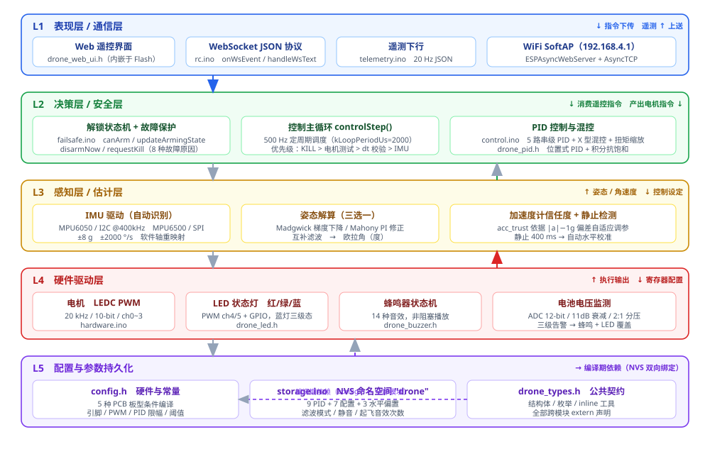

*图 3-1　五层分层架构：表现层 / 决策层 / 感知层 / 硬件驱动层 / 配置与存储*

> 💡 **为什么要分层？**&#x672C;项目支持多种 PCB 板型（4 种已实现、4 种规划中），而板型差异只体现在 `config.h` 的引脚定义里。若硬件访问散落在算法代码中，换板型就要翻遍全工程。把所有 `ledcWrite`、`Wire.begin`、`SPI.transfer` 收敛到 `hardware.ino` 之后，**上层算法完全不知道自己跑在哪个引脚上**——这是本工程能以单份代码覆盖多板型的前提。

### 3.1 模块依赖关系

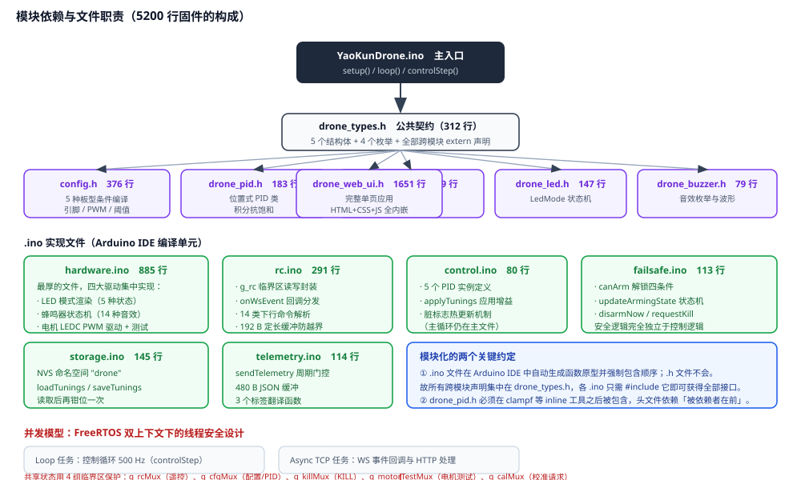

*图 3-2　模块依赖：头文件契约层 + 六个 .ino 实现文件，以及 FreeRTOS 双上下文下的并发模型*

| 文件                               | 行数       | 职责                                                                     |
| -------------------------------- | -------- | ---------------------------------------------------------------------- |
| `YaoKunDrone.ino`                | 598      | 主入口：`setup()` / `loop()`，以及控制流水线 `controlStep()`、WiFi/Web 启动、电压告警与校准辅助 |
| `drone_types.h`                  | 312      | 公共契约：5 个结构体、4 个枚举、inline 工具函数、全部跨模块 extern 声明                          |
| `config.h`                       | 376      | 多 PCB 板型条件编译 + 全部系统常量（引脚 / PWM / PID 限幅 / 阈值）                          |
| `hardware.ino`                   | 885      | 四类硬件驱动实现 + Madgwick / Mahony / Mpu6050 / Mpu6500 / ImuDriver 五个类的方法    |
| `drone_imu.h`                    | 199      | 上述五个类的声明 + `accelToRollPitchDeg` / `isImuStationary` 两个 inline 辅助      |
| `drone_pid.h`                    | 183      | 通用位置式 PID 类，带积分抗饱和与输出限幅（含大段教学式注释）                                      |
| `rc.ino`                         | 291      | 遥控指令临界区读写封装 + WebSocket 事件回调与 14 类下行命令解析                               |
| `control.ino`                    | 80       | 5 个 PID 实例定义、增益应用、脏标志热更新机制                                             |
| `failsafe.ino`                   | 113      | 安全核心：解锁条件、状态机、上锁与紧急停止，完全独立于控制算法                                        |
| `storage.ino`                    | 145      | NVS 命名空间 `"drone"` 的参数加载与保存，含二次限幅                                      |
| `telemetry.ino`                  | 114      | 遥测 JSON 组帧与周期门控，三个枚举标签翻译函数                                             |
| `drone_led.h` / `drone_buzzer.h` | 147 / 79 | LED 模式枚举与呼吸算法 / 音效枚举与蜂鸣器状态机接口                                          |
| `drone_web_ui.h`                 | 1651     | 完整单页前端应用，全内嵌，无外部资源依赖                                                   |

> 💡 **两个必须知道的 Arduino 约定：**&#x2460; `.ino` 文件会被 IDE 自动生成函数原型并强制包含，而 `.h` 不会——所以跨模块声明统一集中在 `drone_types.h`，各 `.ino` 只需 `#include` 它就能拿到全部接口。② `drone_pid.h` 内部用到了 `clampf()`，而 `clampf` 定义在 `drone_types.h` 里，因此该头文件必须在工具函数定义之后才被包含——头文件依赖遵循「被依赖者在前」的基本准则。

### 3.2 代码规模分布


*图 3-3　5173 行代码的分布：前端占三分之一，硬件驱动占近四分之一*

## 四、控制主流程

`loop()` 被刻意做成极简：刷新 LED、推进蜂鸣器状态机，然后检查是否到了控制周期。没到就 `delayMicroseconds(50)` 空转，让出 CPU 给 WiFi 任务；到了就以累加器方式补偿时间基准，把滞后的时间槽一次补齐，然后进入 `controlStep()`。

```bash
// 时间基准与补偿：即使某一周期超时，也不会让后续周期永久漂移
if ((int32_t)(now_us - next_us) >= 0) {
    while ((int32_t)(now_us - next_us) >= 0) next_us += kLoopPeriodUs;
    const float dt = (now_us - last_us) * 1e-6f;
    last_us = now_us;
    controlStep(dt);
    // …电压告警 200 ms、蓝灯 50 ms、告警 LED 覆盖
} else {
    delayMicroseconds(50);
}
```

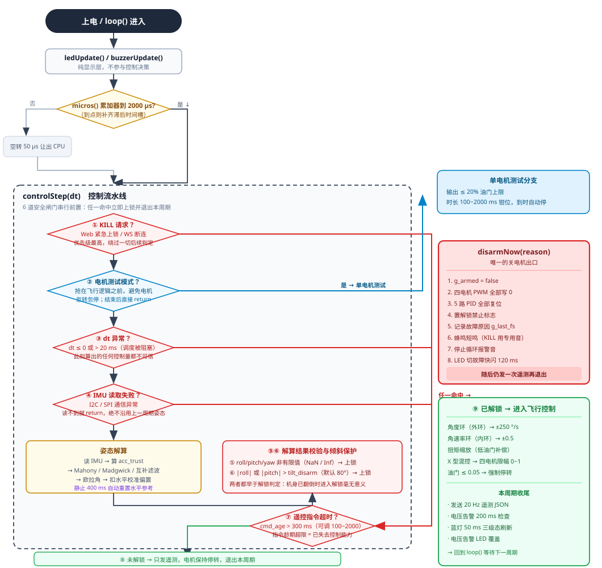

*图 4-1　`controlStep()` 控制流水线：KILL → 电机测试 → dt 校验 → IMU 读取 → 姿态解算 → 倾斜保护 → 遥控超时 → 解锁状态机 → PID 混控*

### 4.1 优先级编排：为什么是这个顺序

这个流水线的顺序不是随意排的，每一步都在为「万一前面已经出问题了，后面不该再执行」服务：

| 次序     | 环节                  | 为什么放在这个位置                                                       |
| ------ | ------------------- | --------------------------------------------------------------- |
| **①**  | KILL 请求             | 最高优先级。用户按下「紧急上锁」时，即使此刻电机正在转、IMU 已经失灵，也必须**立刻**停机，不能被后续任何判定阻挡。   |
| **②**  | 电机测试模式              | 一旦进入测试就要跑完整个时长，中途被飞行逻辑插一脚会造成电机忽转忽停。所以它抢在控制逻辑之前，且结束后直接 `return`。 |
| **③**  | dt 有效性              | dt 异常意味着调度被长时间阻塞，此时算出的任何控制量都不可信，必须先停下来说明原因。                     |
| **④**  | IMU 读取              | 没有姿态数据就无从控制。**注意 IMU 读不到就 return**，绝不拿上一周期的旧姿态凑合——那会让飞机"凭记忆"飞。  |
| **⑤⑥** | 姿态 NaN 校验<br />倾斜保护 | 两者都在解算之后立刻判定，早于解锁状态机。原因很实际：如果飞机已经翻倒或姿态发散，此时进入解锁流程毫无意义。          |
| **⑦**  | 遥控超时                | 指令龄期超限说明操纵者已经失去控制能力，属于"不该继续飞"的信号，排在解锁判定之前。                      |
| **⑧**  | 解锁状态机               | 只有确认"应当处于飞行状态"之后，才进入 PID 与混控。上锁状态下依然发送遥测，保证界面随时能看到状态。           |

> ✅ **一个容易被忽略的正确设计：**&#x5B89;全路径上每一次上锁后都会调用 `sendTelemetry()` 再 `return`。也就是说**即使飞机正在故障，Web 界面依然能实时看到故障原因**。很多飞控在保护状态下就哑了，用户只能盲猜哪里出了问题。

### 4.2 上电启动时序

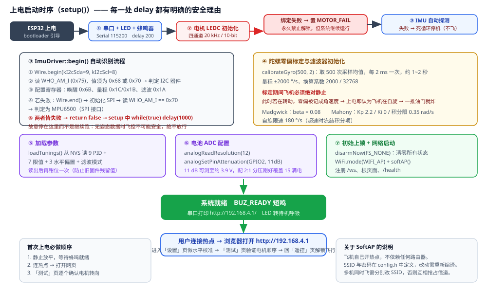

*图 4-2　`setup()` 启动时序：串口 → 电机 LEDC → IMU 自动探测 → 陀螺标定 → 参数加载 → 上锁 → 自建热点*

> ⛔ **两个不可省的等待：**  
>   
> ① **陀螺零偏标定约需 1~2 秒**（500 次采样 × 2 ms）。标定期间飞机必须绝对静止——若在转动，零偏会被记成角速度，飞机上电后认为自己正在自旋，一推油门就会猛甩。  
>   
> ② **IMU 探测失败会直接停机**：`begin()` 返回 false 时 setup 进入 `while(true) delay(1000)` 死循环。这是刻意设计——没有姿态数据时飞控不可能安全，绝不放行让用户以为"能飞"。

电机 LEDC 绑定失败则不同：它只置 `FS_MOTOR_FAIL` 标志并禁止解锁，**系统继续运行**。因为此时 IMU、姿态解算、Web 界面全部正常，用户还有机会打开网页读日志定位问题，直接死循环反而失去诊断手段。

## 五、控制算法详解

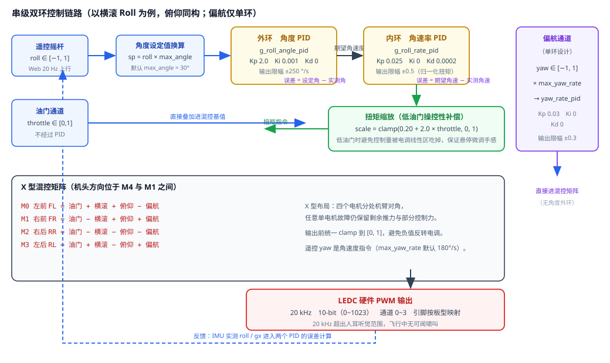

*图 5-1　串级双环控制链路：外环出期望角速度，内环出归一化扭矩，扭矩缩放后进 X 型混控*

### 5.1 为什么要串两个环

单环控制的根本矛盾在于：**角度误差和角速度误差需要不同的增益量纲**。飞控里直接用「角度误差 × Kp」去出电机扭矩，会出现典型的两难——

- 想要响应快 → 调大 Kp → 电机打满饱和 → 一出小角度就直接满油门，没有任何缓冲余量；
- 想要动作柔和 → 调小 Kp → 响应迟钝，稍微快点的手法就变成大幅振荡。

串级把这两个诉求拆到两个不同量纲的环上：

- **外环（角度环）**：输入是"角度差多少度"，输出是"应该转多快（°/s）"。它的输出限幅 ±250 °/s 相当于一道**天然的速度安全阀**——机体最多以 250 °/s 的角速度去追目标姿态，这个速度本身是安全的。
- **内环（角速率环）**：输入是"角速度差多少 °/s"，输出是归一化扭矩。它工作在一个「跟随」问题上，只需把内环稳定地拉住，姿态转换就变得可控而线性。

> 💡 **这是 Betaflight / PX4 等主流飞控都采用的经典结构**，不是本项目的发明。但多数教程讲到「串级 PID」就停了，本工程把每个环的量纲、限幅值和整定思路都写在代码注释里，可以逐行对照理解。

### 5.2 偏航为何只用单环

偏航没有角度外环。因为本机**没有磁罗盘、没有任何绝对航向参考**，偏航角是陀螺仪纯积分出来的，误差会随时间无限制漂移。给一个会漂移的量设外环，等于给积分漂移又套一层积分，稳态误差反而更糟。所以偏航直接采用角速率单环（`g_yaw_rate_pid`），把「指令要转多快」这件事直接做对，不去管最终转到哪个朝向。输出限幅 ±0.3，比横滚俯仰的 ±0.5 更保守——因为偏航只影响两个电机，权限小一点更安全。v1.1 起偏航环带有小积分（Ki=0.005），用积分项自动抵消电机/桨扭矩不对称的合力，消除匀速自旋（见 5.5 节说明）。


### 5.3 X 型混控矩阵

```bash
yaw_t = yaw_torque * kYawTorqueSign   // 偏航符号适配系数（见下方说明）
M0 左前 FL = throttle + roll_torque + pitch_torque - yaw_t
M1 右前 FR = throttle - roll_torque + pitch_torque + yaw_t
M2 右后 RR = throttle - roll_torque - pitch_torque - yaw_t
M3 左后 RL = throttle + roll_torque - pitch_torque + yaw_t
```

符号的来历：横滚靠对角电机差速（FL+RL 增、FR+RR 减产生右倾），俯仰靠前后电机差速，偏航靠同侧反向旋转（左侧减、右侧增产生偏航）。三者叠加后再限幅到 `[0, 1]`。

**偏航符号为什么要乘系数**：混控默认约定电机旋向为「左前=逆时针、右前=顺时针、右后=逆时针、左后=顺时针」（对角两两同向）。而 v1.1 实测装机的旋向恰好**每颗都相反**（左前 GPIO16=顺、右前 GPIO6=逆、右后 GPIO5=顺、左后 GPIO15=逆，对角仍两两同向）——这种布局本身合法，但偏航反扭矩方向整体翻转：不翻转符号时偏航环变成**正反馈**，起飞后机头越转越快、配合倾斜后推力矢量绕圈，表现为「加速自旋 → 螺旋升天」。解决方式是在 PID 输出之后、进混控之前乘 `kYawTorqueSign = -1`（`config.h`）：翻转点选在这里，摇杆杆向、遥控器通道方向、姿态球全部不用改；横滚/俯仰扭矩只与电机**位置**有关，位置没变故不受影响。

> ⚠️ **混控符号必须和实际电机安装方向一致，否则偏航环会失效甚至正反馈——表现为起飞后匀速自旋（布局对角同向但整体反向）或加速自旋螺旋升天（相邻同向的非法布局，任何混控都救不了）。**&#x9996;次装机请务必「不装桨」用「测试」页逐个确认电机转向（见第十二节第 4 步），再决定是调电机线序还是改 `kYawTorqueSign`。

### 5.4 低油门扭矩缩放

```bash
const float torque_scale = clampf(cfg.torque_scale_min + throttle * cfg.torque_scale_slope, 0.0f, 1.0f);
// 默认 = 0.20 + throttle × 2.0
roll_torque  = g_roll_rate_pid.update(...)  * torque_scale;
```

为什么需要它：无刷电调在低油门区存在明显的死区与非线性。悬停时油门在 30% 上下，正是线性最差的区域，直接输出 0.1 的扭矩差，实际转速差可能只有 0.02——摇杆推到底飞机几乎没反应，"手感发死"。乘上缩放系数后（30% 油门时 scale ≈ 0.8），同样的 PID 输出能换来更明显的实际转速差，微调就灵活了。

代价是高油门时缩放系数会超过 1 被钳到 1，等于不做补偿——这正是想要的：高速时本来就不需要额外放大，否则容易振荡。

### 5.5 PID 参数默认值

| 控制器             | 默认 Kp / Ki / Kd    | 输出限幅     | 物理含义            |
| --------------- | ------------------ | -------- | --------------- |
| 角度环（横滚 / 俯仰共用）  | 2.0 / 0.001 / 0    | ±250 °/s | 输出是期望角速度，单位 °/s |
| 角速率环（横滚 / 俯仰共用） | 0.025 / 0 / 0.0002 | ±0.5     | 输出是归一化扭矩，无量纲    |
| 偏航角速率环          | 0.030 / 0.005 / 0  | ±0.3     | 限幅更保守，因只影响两电机   |

注意外环 Ki = 0.001 **很小**——这是有意的。姿态环的稳态误差本来就由重力静力学自然补偿（机体倾斜时重力本身产生恢复力矩），过大的积分反而会在持续倾斜时积累大量风控量，退出倾斜时产生严重过冲。横滚/俯仰的角速率环完全不用积分（Ki = 0），因为陀螺零偏在标定阶段已经被减掉了。

**偏航环的 Ki = 0.005 是 v1.1 新加的**（此前为 0）。偏航是单层角速率环，没有外环兜底，而四颗电机与桨的扭矩**永远不可能完全对称**——这个不对称合力需要一个恒定的反向扭矩去抵消。纯 P 控制器消除稳态扰动的唯一方式是「保留一点残余转速」：转起来产生误差、P 项输出反扭矩与之平衡，于是飞机会**匀速缓慢自旋**（近地面地效还会放大不对称）。加入小积分后，I 项约 1 秒内即可积出抵消不对称所需的反扭矩，自旋消失；PID 类自带「输出限幅时积分 ×0.99 衰减」的抗饱和机制，不会积爆。⚠️ 从 v1.0 升级且板子里保存过参数的用户：请到网页把偏航 Ki 手动改为 0.005（或点「恢复默认」）；整片刷写会清 NVS，新默认自动生效。

## 六、姿态解算

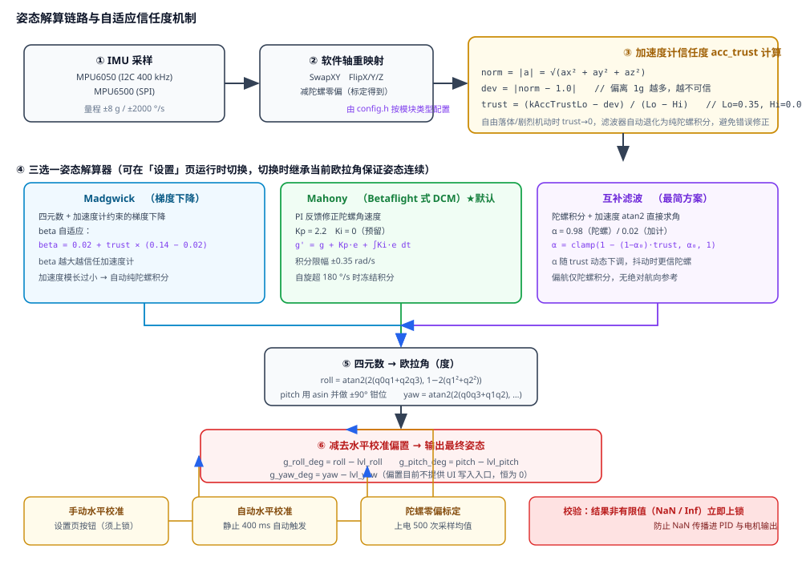

*图 6-1　姿态解算链路：IMU 采样 → 轴重映射 → 信任度计算 → 三选一解算器 → 欧拉角 → 扣除水平偏置*

### 6.1 加速度计信任度：整套解算的"理智开关"

这是本工程在姿态估计上最值得说的一处设计。加速度计能测重力方向，陀螺仪能测角速度，两者是互补的——但**加速度计只在"没有额外加速度干扰"时才可信**。飞机一拉升，加速度计读到的是「重力 + 推力加速度」的合力，方向就不再代表水平面了；如果此时还拿它去修正姿态，就会把不该有的修正加进去，姿态越修越偏。

```bash
const float acc_norm = sqrtf(ax*ax + ay*ay + az*az);
const float dev = fabsf(acc_norm - 1.0f);        // 偏离 1g 多少
if (kAccTrustLo > kAccTrustHi)
    acc_trust = (kAccTrustLo - dev) / (kAccTrustLo - kAccTrustHi);   // 线性映射到 0~1
acc_trust = clampf(acc_trust, 0.0f, 1.0f);
```

| 参数            | 值    | 含义                                   |
| ------------- | ---- | ------------------------------------ |
| `kAccTrustHi` | 0.08 | 偏离小于 0.08 g 视为完全可信，trust = 1         |
| `kAccTrustLo` | 0.35 | 偏离大于 0.35 g 视为完全不可信，trust = 0（纯陀螺积分） |

trust 随后被送进两个地方：Madgwick 的 β 线性插值（`β = 0.02 + trust × 0.12`）、互补滤波的 α 动态下调，以及 Mahony 的 PI 修正项整体乘以 trust。三套解算器因此**共享同一个"该信谁"的判断**，行为一致。

### 6.2 三套解算器对比

| 解算器        | 状态     | 算法要点                                                                                                 | 适用场景                                       |
| ---------- | ------ | ---------------------------------------------------------------------------------------------------- | ------------------------------------------ |
| **Mahony** | **默认** | 用外积计算姿态与重力方向的误差向量 e，以 `g' = g + Kp·e + ∫Ki·e dt` 修正角速度再积分四元数。积分限幅 ±0.35 rad/s，自旋超 180 °/s 时冻结积分防止发散。 | 默认选择。计算量适中、参数少、对零偏不敏感，与 Betaflight 同源，资料多。 |
| Madgwick   | 可选     | 梯度下降法，把重力对齐问题写成目标函数，用 β 步长做梯度下降。β 自适应插值到 0.02~0.14。加速度模长过小时自动切纯陀螺积分。                                 | 想自己调 β 感受"信任度"效果时；需要理解梯度下降的读者。             |
| 互补滤波       | 可选     | 最朴素：陀螺积分 + 加速度 `atan2` 直接求角，按 α = 0.98 一阶互补。α 随 trust 动态上调（更信陀螺）。                                    | 教学首选，公式最直观；也是验证另两套是否出问题的对照组。               |

> 💡 **切换时如何保持姿态连续？**&#x82E5;直接换解算器，新解算器内部四元数还是单位四元数（水平），而飞机实际已经倾斜了几十度——切换瞬间姿态会突然"跳回零"，控制环立刻输出满扭矩把飞机抽飞。所以代码里先把**旧解算器的当前欧拉角**取出来，用 `setEulerDeg()` 注入新解算器，互补滤波则直接接管内部状态，三者对齐后再继续。这是本工程里一个容易被忽略但至关重要的细节。

### 6.3 水平校准的两条路径

| 方式       | 触发条件                                               | 行为                                                                                    |
| -------- | -------------------------------------------------- | ------------------------------------------------------------------------------------- |
| **手动校准** | 「设置」页点击按钮（须上锁，发 `CAL,LEVEL`）                       | 读取当前加速度计解算的水平角存入 `g_level_roll_offset_deg` / `g_level_pitch_offset_deg`，立即存 NVS，三短鸣确认 |
| **自动校准** | 上锁 + 静止满 400 ms（加速度模长偏离 < 0.10 g 且三轴角速度 < 1.5 °/s） | 用加速度计读数覆盖解算姿态，并同步重置三个解算器与互补滤波内部状态                                                     |

输出姿态始终是「解算值 − 校准偏置」，所以偏置只存一次、长期生效。偏航偏置变量虽然存在（`g_level_yaw_offset_deg`），但当前 UI 没有写入入口，恒为 0。

> ⛔ **换 IMU 模块后必须重跑水平校准。**&#x4E0D;同模块的贴装朝向和零偏都不同，校准偏置是绑定在"这块板子 + 这个模块"上的。换模块不清零，姿态球会持续歪着，自动校准也会一直按错误基准重置。

## 七、安全机制

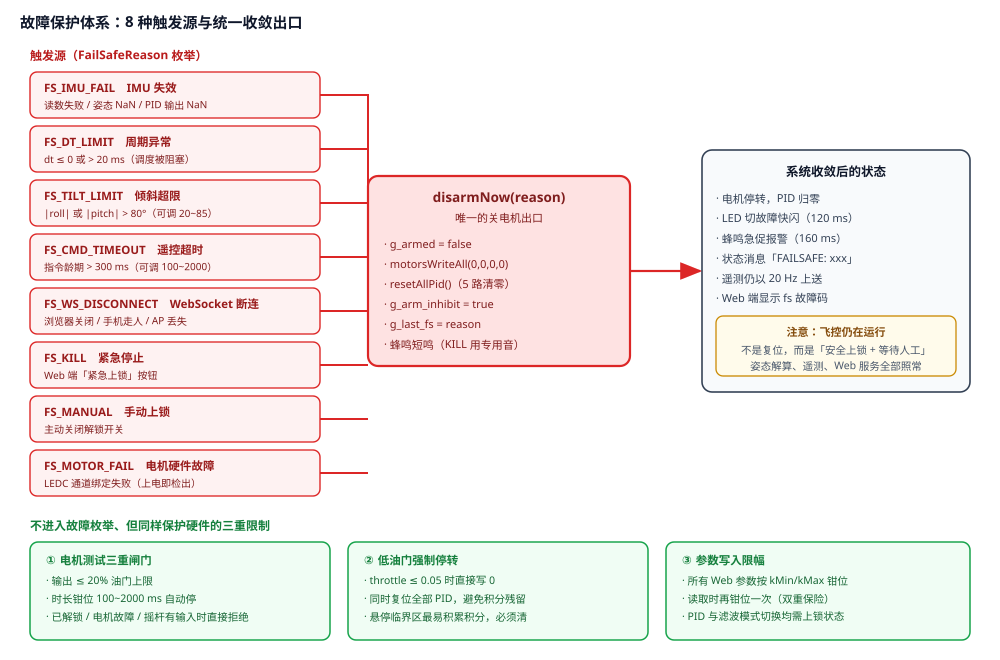

*图 7-1　八种故障触发源全部汇聚到 `disarmNow()` 单一出口，加上三道不进入枚举的额外保护*

### 7.1 统一上锁出口

无论从哪条路径发现故障，最终都调用同一个函数 `disarmNow(reason)`。它按固定顺序做七件事：

1. 清除已解锁标志 `g_armed = false`
2. 四个电机 PWM 全部写 0
3. 复位全部 5 路 PID（清零积分与微分历史）
4. 置解锁禁止标志 `g_arm_inhibit = true`
5. 记录故障原因到 `g_last_fs` 并写状态消息
6. 蜂鸣短鸣（KILL 用专用音，因为 KILL 已经播过 `BUZ_KILL`）
7. 停止任何循环报警音

> 💡 **为什么坚持"单一出口"？**&#x5982;果每个故障分支各自写一套关电机逻辑，早晚会有某个分支忘了清积分或者忘了停报警音。用户看到的现象是"电机停了但蜂鸣器还在尖叫"或者"解锁后飞机猛地一抽"——这类 bug 极难定位。收敛到一个函数后，新增故障类型只需加一个枚举值，代码改动量归零。

> 📌 **v1.1 起芯片欠压复位（brownout）已关闭**（`setup()` 首条语句清 `RTC_CNTL_BROWN_OUT_ENA`，与 Flix 飞控同款做法）。原因：1S 锂电 + LDO 供电压差余量小，四电机满载浪涌会把 3.3V 轨拉到芯片欠压阈值（约 2.43V）以下，触发芯片硬复位——实测表现为「放地上推油到即将离地必重启、手上测试却正常」（临界油门=电流最大时刻）。关闭后软件侧 `FS_` 故障码不受影响，但**真欠压时芯片不再自保护复位**，只剩蜂鸣器三级电压告警（<3.70V 慢鸣 / <3.50V 快鸣 / <3.30V 急促），请飞手留意电压、及时返航。治本方向：供电线加粗、电源加电解电容、或用独立 BEC 给飞控供电。

### 7.2 解锁状态机

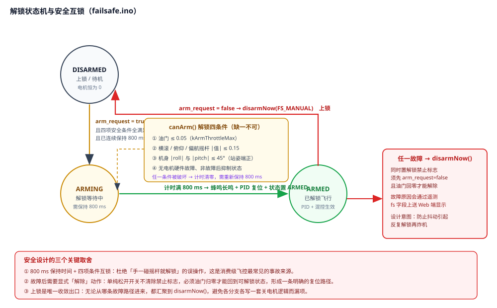

*图 7-2　三态解锁状态机：DISARMED → ARMING → ARMED，含四条件互锁与故障抑制*

#### 解锁四条件（缺一不可）

| 条件   | 要求                                         | 防的是什么              |
| ---- | ------------------------------------------ | ------------------ |
| ① 油门 | ≤ 0.05（`kArmThrottleMax`）                  | 避免带油门解锁，一解锁电机就猛转   |
| ② 摇杆 | 横滚 / 俯仰 / 偏航 |值| ≤ 0.15（`kStickCenterMax`） | 避免带着操纵指令解锁，起飞瞬间就偏航 |
| ③ 姿态 | |roll| 与 |pitch| ≤ 45°                     | 避免倒着或大角度倾斜时解锁      |
| ④ 状态 | 无电机硬件故障、不在故障抑制中                            | 避免电机故障后反复尝试解锁      |

四条件必须**连续保持 800 ms**（`kArmHoldMs`）才真正解锁。任何一帧被破坏，计时立即清零重来。这个设计直接针对消费级飞控最常见的事故——"手一碰摇杆开关就解锁起飞"。

### 7.3 故障后的恢复路径

> ⚠️ **注意：故障后不会自动恢复可解锁状态。**  
>   
> 必须先**关闭解锁开关**（`arm_request = false`）**且把油门归零**，解锁禁止标志才被清除。这个"必须显式复位"的设计是有意的：故障刚发生时，机体姿态、电机状态往往还没稳，让操作者主动做一次"我确认安全了"的动作，比系统自作主张重新允许解锁安全得多。

### 7.4 三道不进入枚举的额外保护

| 保护           | 规则                                                                 |
| ------------ | ------------------------------------------------------------------ |
| **低油门强制停转**  | `throttle ≤ 0.05` 时直接写 0 并复位全部 PID。悬停临界区最容易积累积分，必须清。               |
| **电机测试三重闸门** | 输出 ≤ 20%；时长钳位 100~2000 ms 且到时自动停；已解锁 / 电机故障 / 摇杆有输入时命令直接被拒绝并回 ack。 |
| **参数双重限幅**   | 写入时钳位，从 NVS 读出后再钳位一次，防止旧固件残留值造成越界。                                 |

## 八、通信与 Web 遥控

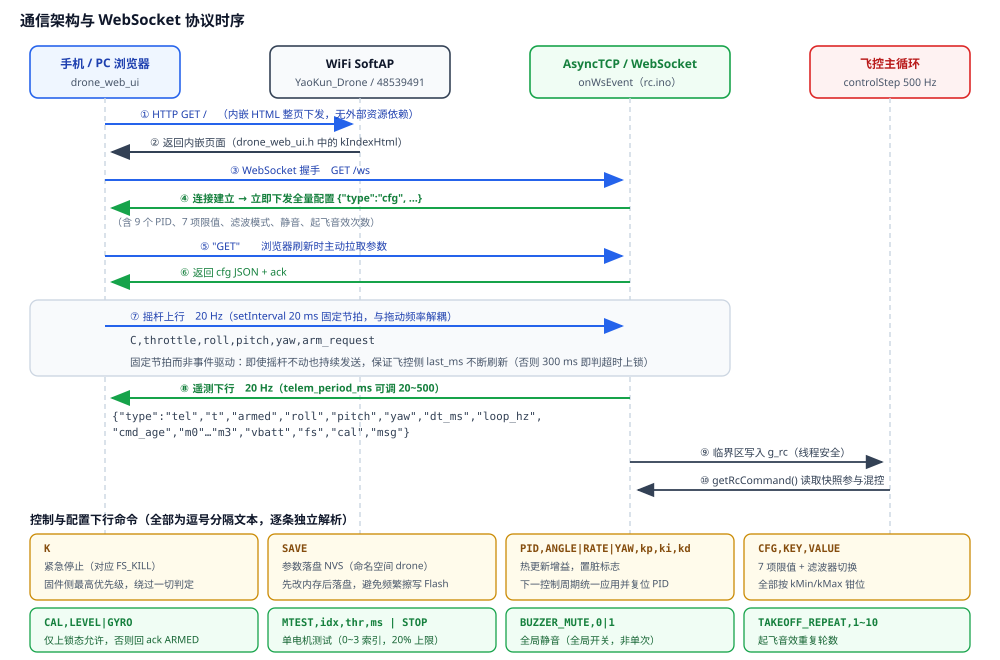

*图 8-1　HTTP 取页 → WebSocket 握手 → 配置下发 → 20 Hz 双向循环 → 命令通道全景*

### 8.1 通信链路

飞控上电即开启 SoftAP 并注册三类路由：`/` 返回内嵌单页应用，`/health` 返回 `OK`（用于探测设备是否在线），`/ws` 是 WebSocket 端点。浏览器访问 `http://192.168.4.1` 拿到页面后立刻建立 WebSocket 连接，连接建立瞬间固件就把全量配置推给前端，之后进入 20 Hz 双向循环。

> 💡 **为什么用 WebSocket 文本帧而不是二进制 MAVLink？**&#x672C;工程的定位是"浏览器直连遥控"，操作者就是拿着手机的人而不是地面站。文本 JSON 换来三个实际好处：① 串口助手、浏览器控制台、Python 脚本都能直接收发，调试门槛为零；② 前端解析一行 `JSON.parse`，不需要引入 mavlink 解析库和消息注册表；③ 没有字节序和字段对齐问题，人肉可读。代价是带宽略高（每帧约 200 字节 × 20 Hz ≈ 4 KB/s），对 WiFi 来说完全无压力。

### 8.2 上行：遥控指令（20 Hz）

```bash
C,throttle,roll,pitch,yaw,arm_request
例：C,0.320,-0.150,0.080,-0.200,1
    油门 30%   横滚     俯仰     偏航     解锁请求
```

前端用 `setInterval(…, 20)` 固定节拍发送，与用户手势频率无关。这是为了保证**即使摇杆不动，指令帧也持续刷新**——固件侧靠 `cmd_age > cmd_timeout`（默认 300 ms）判定失联，若改成"只有动了才发"，静止状态下 300 ms 后就会被判定超时上锁。

#### 其它上行控制命令

| 命令                                | 作用                                  |                      |                                     |
| --------------------------------- | ----------------------------------- | -------------------- | ----------------------------------- |
| `K`                               | 紧急停止，对应 `FS_KILL`，固件侧最高优先级          |                      |                                     |
| `GET`                             | 主动拉取全量配置（浏览器刷新或点「获取参数」）             |                      |                                     |
| `SAVE`                            | 把当前内存参数落盘到 NVS（对应界面「保存参数」）          |                      |                                     |
| \`PID,ANGLE\\                     | RATE\\                              | YAW,kp,ki,kd\`       | 热更新某组 PID 增益，置脏标志，下一控制周期统一应用并复位 PID |
| `CFG,KEY,VALUE`                   | 修改 7 项飞行限值或切换滤波器模式，全部按 kMin/kMax 钳位 |                      |                                     |
| \`CAL,LEVEL\\                     | GYRO\`                              | 请求水平校准 / 陀螺标定，仅上锁态允许 |                                     |
| `MTEST,idx,thr,ms` / `MTEST,STOP` | 单电机测试 / 停止测试                        |                      |                                     |
| \`BUZZER_MUTE,0\\                 | 1\`                                 | 蜂鸣器全局静音（写入即存 NVS）    |                                     |
| `TAKEOFF_REPEAT,1~10`             | 起飞音效重复轮数                            |                      |                                     |

### 8.3 下行：遥测（20 Hz）

```bash
{"type":"tel","t":1234567,"armed":1,"roll":-3.21,"pitch":1.05,"yaw":45.30,
 "dt_ms":2.01,"loop_hz":497.5,"cmd_age":42,"m0":0.310,"m1":0.298,
 "m2":0.295,"m3":0.305,"vbatt":3.842,"fs":0,"cal":"IDLE","msg":"ARMED"}
```

| 字段                  | 含义                            |
| ------------------- | ----------------------------- |
| `armed`             | 是否已解锁                         |
| `roll/pitch/yaw`    | 姿态角（度），已扣除水平校准偏置              |
| `dt_ms` / `loop_hz` | 实际控制周期与循环频率，调参时判断算力是否吃紧的关键指标  |
| `cmd_age`           | 遥控指令龄期（毫秒），逼近 300 ms 就要松手找问题了 |
| `m0~m3`             | 四电机实际输出（0~1），判断混控是否正确、是否饱和    |
| `vbatt`             | 电池电压，读取失败时为 `null` 而非 0       |
| `fs`                | 故障原因码，取值见 7.1 节               |
| `cal` / `msg`       | 校准状态与人类可读状态消息                 |

#### ack 应答机制

所有控制命令都有 `{"type":"ack","op":"…","tag":"…","ok":0|1,"msg":"…"}` 应答，`msg` 给出具体原因：`ARMED`（已解锁时下发校准）、`MOTOR_FAIL`、`RC_ACTIVE`（摇杆有输入时下发电机测试）、`BAD_IDX`、`QUEUED`、`RUN`、`MUTED` 等。前端把它映射为中文提示并显示 2 秒，让「改了参数没生效」这类问题变得可诊断。

### 8.4 Web 界面

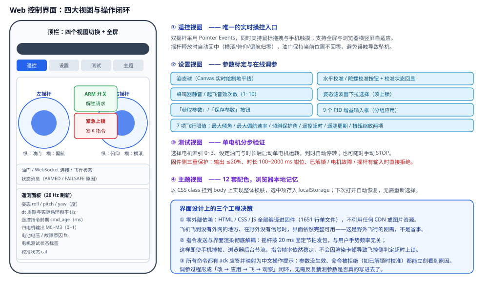

*图 8-2　四大视图：遥控（双摇杆 + 遥测面板）、设置（姿态球 + 调参）、测试（单电机）、主题（12 套配色）*

> 💡 **零外部依赖不是省事，是刚需。**&#x6574;个界面 1651 行全部编译进固件，不引用任何 CDN、字体文件或图片。野外飞行没有外网、在干扰环境下 CDN 请求可能超时几分钟——如果界面依赖外部资源，那正是飞机最容易出问题的时候。所以这里刻意做成"一个 HTML 文件就是完整应用"，浏览器拿到页面后立刻可用。

| 视图     | 内容                                                                                          |
| ------ | ------------------------------------------------------------------------------------------- |
| **遥控** | 左摇杆（纵油门 / 横偏航）、右摇杆（纵俯仰 / 横横滚）、ARM 开关、紧急上锁按钮、油门与连接状态、状态消息、8 项遥测读数                            |
| **设置** | Canvas 姿态球（含地平线）、三轴读数、水平校准与陀螺标定按钮及状态回显、蜂鸣器静音与起飞音效次数、滤波器下拉选择、获取/保存参数、9 个 PID 输入框、7 项飞行限值     |
| **测试** | 电机索引选择、油门与时长设定、单电机启停                                                                        |
| **主题** | 12 套配色网格（浅色 / 暗黑 + 海棠 / 朱红 / 藕荷 / 湖蓝 / 晴蓝 / 藏青 / 葱绿 / 甘青 / 翡翠 / 松花），点击即换肤，选中项存 localStorage |

#### 摇杆回中的设计取舍

右摇杆（俯仰 / 横滚）松手时三轴立即归零，回到「姿态自稳」状态；左摇杆的油门则**保持当前位置不回零**。若油门也回零，飞机会瞬间掉高度。刻意让两个摇杆行为不同，是为了让"松手"这个动作的含义明确——姿态回稳、高度自己掉，操作者心里有数。

## 九、音效与灯效系统

这套飞控没有屏幕，**蜂鸣器和三色灯就是它的「仪表盘」**。作者把 14 种提示音和 3 色灯语设计成一套完整的反馈语言：不用连网页、不用看串口，光靠听和看就能知道飞机正处在什么状态、出了什么事。整套系统的实现原则是**彻底的非阻塞**——所有音效灯效都由 `millis()` 时间戳驱动的状态机刷新（`buzzerUpdate()` / `ledUpdate()` 在主循环里轮询），全程没有一处 `delay()`，500 Hz 控制循环永远不会被一声「嘀」卡住。

### 9.1 全流程声光联动

先看一遍从上电到降落的完整生命周期——每个阶段声音和灯光都在配合讲故事：


*图 9-1　声光联动全流程：8 个阶段的声音 + 红绿灯 + 蓝灯组合，以及随时可能插入的故障分支*

> 💡 **两条反馈通道各管一摊，互不干扰：**&#x7EA2;绿灯表达**飞控核心状态**（启动 / 待机 / 解锁 / 故障），蓝灯表达**遥控链路状态**（有没有连上网页、是否真的在飞）。这样「灯在快闪」时你不用猜是故障还是飞行——看颜色就分得清。

### 9.2 蜂鸣器：14 种音效的节奏谱

14 种音效按用途分五类：状态播报（单次）、校准确认（连击）、起飞（重复）、等待催促（循环）、报警（循环）。每一段的节奏都对应 `hardware.ino` 里状态机的真实参数：


*图 9-2　14 种音效的节奏谱：实心块 = 蜂鸣器响，横轴为毫秒；右侧为触发场景*

| 音效（枚举）                | 节奏                 | 触发场景与要点                                                          |
| --------------------- | ------------------ | ---------------------------------------------------------------- |
| `BUZ_POWER_ON` 上电     | 单声 200 ms          | `setup()` 完成硬件初始化后立即响，等于「通电自检通过」。                                |
| `BUZ_READY` 就绪        | 单声 100 ms          | WiFi 热点与 Web 服务起来后响，与蓝灯转入慢闪同步。                                   |
| `BUZ_SHORT_BEEP` 短鸣   | 单声 100 ms          | 关闭 ARM 时确认上锁——听到它才说明电机真的断电了。                                     |
| `BUZ_LONG_BEEP` 长鸣    | 单声 400 ms          | 解锁开关保持约 0.8 s 达成时响起，**从这一刻起桨下就是危险区**。                            |
| `BUZ_MOTOR_TEST` 电机测试 | 单声 50 ms           | 每次启动单电机测试前提示，留出「手离开桨」的反应时间。                                      |
| `BUZ_DOUBLE_BEEP` 双短鸣 | 100 / 停 100 / 100  | Web 端「陀螺仪校准」成功。                                                  |
| `BUZ_TRIPLE_BEEP` 三短鸣 | 100 ×3，间隔 100      | Web 端「水平校准」成功。两种校准靠连击次数区分，闭眼都能分。                                 |
| `BUZ_TAKEOFF` 起飞      | 双短鸣 × 3 轮（1~10 可设） | 解锁后**首次推油门**触发一次（`g_takeoff_sounded` 标志防重复）。                     |
| `BUZ_QUICK_TICK` 滴答   | 周期 200 / 响 50，循环   | 解锁等待期的催促声，与红绿慢闪同步，松手即停。                                          |
| `BUZ_FAST_ALARM` 急促报警 | 周期 160 / 响 80，循环   | 六类故障（IMU 失效 / 遥控超时 / 姿态异常 / 倾斜过大 / PID 异常 / 周期超限）任一触发。           |
| `BUZ_VOLT_ALERT_SLOW` | 周期 1000 / 响 200    | 单体电压 < 3.70 V，Ⅰ 级。                                               |
| `BUZ_VOLT_ALERT_MED`  | 周期 500 / 响 100     | < 3.50 V，Ⅱ 级。                                                    |
| `BUZ_VOLT_ALERT_FAST` | 周期 200 / 响 50      | < 3.30 V，Ⅲ 级，濒临过放。                                               |
| `BUZ_KILL` 紧急停止       | 100 / 停 50 / 100   | 收到 `kill` 指令立即断油门时的专用音，**不会被其它音效覆盖**（`buzzerPlay()` 里唯一有豁免权的音效）。 |


> ⚠️ **一个值得知道的细节：**&#x8D77;飞音效的注释写的是「重复多次双短鸣」，但按子状态机逐步推演，`phase==0` 分支只负责关断、不补发声——实际听感是第 1 轮完整双短鸣（0 / 200 ms），第 2、3 轮各只在 600 / 1000 ms 响一声。若希望每轮都是规整的双短鸣，把 `phase==0` 分支里的 `buzzerSet(false)` 改为先响一声再进入 `phase==1` 即可。这是读代码时发现的**行为与注释不符**之处，先如实记录。

### 9.3 三色灯语

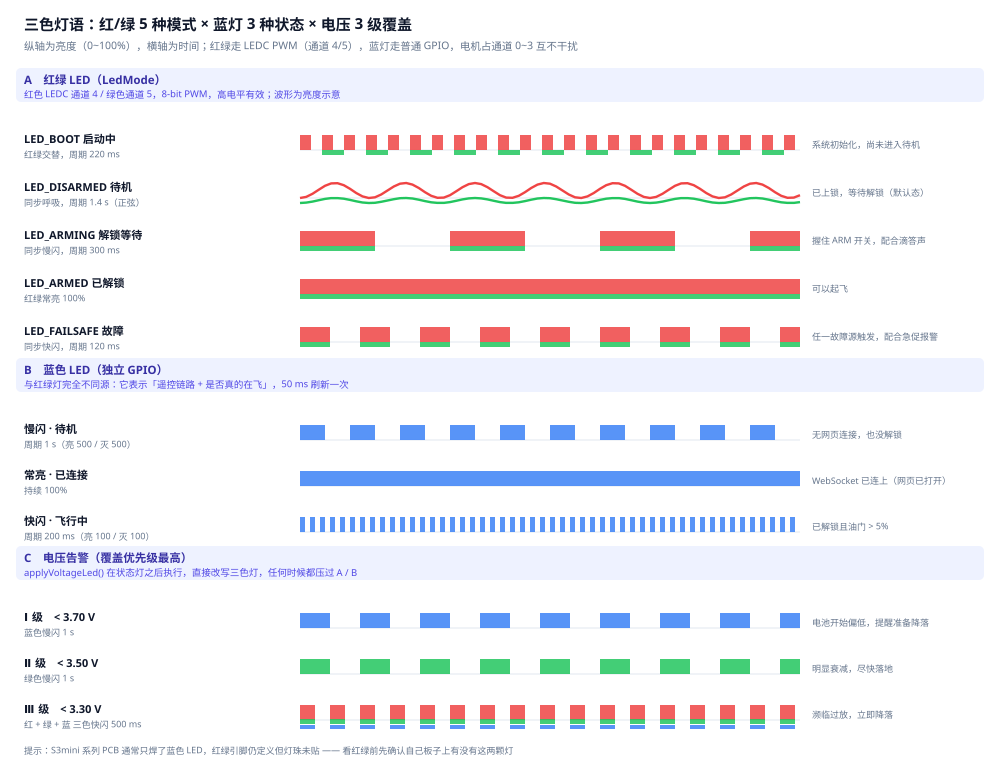

*图 9-3　三色灯语：红/绿 5 种模式、蓝灯 3 种状态、电压 3 级覆盖的亮度-时间曲线*

红绿灯由 `g_led_mode` 驱动（LEDC 通道 4/5，与电机通道 0~3 完全隔离，互不打架），蓝灯由主循环里一段 50 ms 刷新的独立逻辑控制：

| 灯                                     | 状态                | 表现与含义                                     |
| ------------------------------------- | ----------------- | ----------------------------------------- |
| **红 + 绿**<br />LEDC PWM<br />通道 4 / 5 | `LED_BOOT` 启动中    | 红绿交替闪 220 ms——系统初始化，尚未进入待机。               |
| **红 + 绿**<br />LEDC PWM<br />通道 4 / 5 | `LED_DISARMED` 待机 | 红绿同步呼吸 1.4 s（正弦渐变）——已上锁，**呼吸灯 = 可以安全靠近**。 |
| **红 + 绿**<br />LEDC PWM<br />通道 4 / 5 | `LED_ARMING` 解锁等待 | 同步慢闪 300 ms + 滴答声——正在等你确认。                |
| **红 + 绿**<br />LEDC PWM<br />通道 4 / 5 | `LED_ARMED` 已解锁   | 红绿常亮——电机带电，远离桨。                           |
| **红 + 绿**<br />LEDC PWM<br />通道 4 / 5 | `LED_FAILSAFE` 故障 | 同步快闪 120 ms + 急促报警——需要立即处理。               |
| **蓝**<br />普通 GPIO<br />50 ms 刷新      | 慢闪（周期 1 s）        | 待机：没有网页连接，也未解锁。                           |
| **蓝**<br />普通 GPIO<br />50 ms 刷新      | 常亮                | WebSocket 已连接——有人正开着网页遥控它。                |
| **蓝**<br />普通 GPIO<br />50 ms 刷新      | 快闪（周期 200 ms）     | **飞行中**：已解锁且油门 > 5%。「蓝灯快闪 = 我真的在飞」。       |
| **电压覆盖**<br />优先级最高                   | Ⅰ 级 < 3.70 V      | 蓝色慢闪——电量偏低，准备降落。                          |
| **电压覆盖**<br />优先级最高                   | Ⅱ 级 < 3.50 V      | 绿色慢闪——明显衰减，尽快落地。                          |
| **电压覆盖**<br />优先级最高                   | Ⅲ 级 < 3.30 V      | 红绿蓝三色快闪——濒临过放，立即降落。                       |

> 💡 **为什么要一层「覆盖」而不是改状态？**&#x7535;压告警由 `applyVoltageLed()` 在状态灯刷新**之后**直接改写三色灯，不改动 `g_led_mode` 本身。这样告警只「借走」灯几秒，电压恢复或降落后灯语原样接续，两个逻辑完全解耦——比在五个 LedMode 里各插一种告警态干净得多。

### 9.4 设计上的几个讲究

- **非阻塞状态机**：每种音效都是「子状态 + 截止时间戳」的小状态机，由 `buzzerUpdate()` 轮询推进。任何时刻主循环都不会等一声播完——这对 500 Hz 实时控制是底线要求。
- **静音只拦「发声」**：`buzzerSet()` 开头检查静音标志：静音时状态机照常推进，只是不驱动引脚。取消静音后一切自然接续，不会出现「静音期间状态卡死」。
- **循环音单独管理**：`buzzerStopLoop()` 只停 5 种循环音（滴答 / 报警 / 三级电压），**不砍刚触发的单次音**。所以上锁短鸣不会被紧接着的报警「吃掉」，提示音永远完整。
- **参数持久化**：静音开关与起飞音效轮数在 Web 端设置后写入 NVS（`BUZZER_MUTE` / `TAKEOFF_REPEAT` 命令），断电重启自动恢复，不用每次重设。

### 9.5 想自己加一种音效？三步就够

1. **注册枚举**：`drone_types.h` 的 `BuzzerPattern` 里加一项（如 `BUZ_CAL_FAIL`）。
2. **写节奏**：单次音只需在 `buzzerPlay()` 的 switch 里给时长；复杂节奏（连击/循环）在 `buzzerUpdate()` 里加一个 `if (g_buzzer_pattern == ...)` 分支，用 `g_buzzer_sub_state` 推进。
3. **找位置触发**：在对应业务点调 `buzzerPlay(你的音效)`，完毕。

> ✅ **听音辨障速查：**&#x4E00;声 200 ms = 上电自检过　·　一声 100 ms = 就绪 / 已上锁　·　两短 = 陀螺校准好　·　三短 = 水平校准好　·　长鸣 = 已解锁（危险）　·　嘀嘀嘀（快）= 故障　·　慢滴滴→快滴滴 = 电压在掉　·　两声急促 = 紧急停止。

## 十、硬件与引脚定义

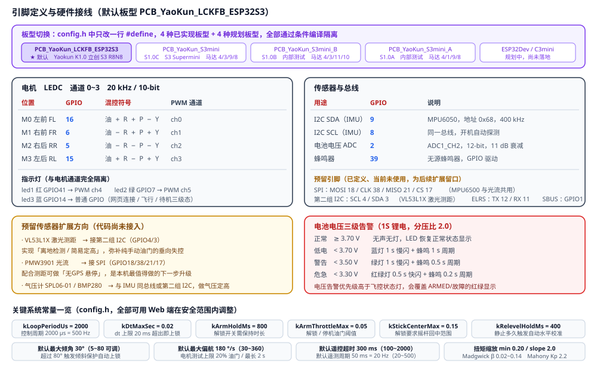

*图 10-1　板型切换方式、默认板型完整引脚表、预留扩展口与电压告警阈值*

### 10.1 板型与切换（4 种已实现）

所有板型差异集中在 `config.h` 的条件编译里，切换只需修改开头的一行 `#define`。文件开头有一个兜底判断：若 `PCB_YaoKun_*` 系列宏一个都没定义，自动选中默认板型 `PCB_YaoKun_LCKFB_ESP32S3`。要注意的是：**随手定义一个还不存在的规划板型宏（如 `PCB_YaoKun_ESP32Dev`）不会报错**——它会被兜底逻辑拉回默认板型，用默认引脚编译通过，末尾的 `#error` 分支实际不可达。所以切换板型时只应填下表四个已实现的宏之一。

| 板型宏                                  | 对应硬件                                 | 电机引脚            |
| ------------------------------------ | ------------------------------------ | --------------- |
| `PCB_YaoKun_LCKFB_ESP32S3`<br />★ 默认 | Yaokun K1.0 立创 ESP32-S3 R8N8 全功能板    | 16 / 6 / 5 / 15 |
| `PCB_YaoKun_S3mini`                  | YaoKun S1.0C　ESP32-S3 Supermini（已开源） | 8 / 4 / 3 / 9   |
| `PCB_YaoKun_S3mini_B`                | YaoKun S1.0B　内部测试版                   | 10 / 4 / 3 / 11 |
| `PCB_YaoKun_S3mini_A`                | YaoKun S1.0A　内部测试第 1 版               | 8 / 4 / 1 / 9   |
| `PCB_YaoKun_ESP32Dev`                | 规划中：YaoKun D1.0　适配 30P ESP32 开发板     |                 |

> ⚠️ **S3mini 系列引脚紧张**，实际 PCB 上红绿 LED 可能并未焊接（引脚号仍定义着，只是接了 LED 灯珠不亮）。另外 S1.0A/B 是内部测试版本，引脚对应实物，不建议直接照抄到自己的板子上。

### 10.2 IMU 轴映射

不同 IMU 模块的贴装朝向不一样，代码用四个软件开关在**软件层**做重映射，不需要改动驱动：

| 模块                 | SwapXY | FlipX    | FlipY    | FlipZ |
| ------------------ | ------ | -------- | -------- | ----- |
| 原厂 MPU6050（4×4 mm） | true   | false    | false    | false |
| 国产 MPU6050（3×3 mm） | true   | false    | false    | false |
| MPU6500 模块         | true   | **true** | **true** | false |

`SwapXY` 分支里除了交换 X/Y，还把两轴角速度同时取反——这不是笔误：交换坐标系后手性会翻转，必须同时反向才能保持右手系。

> 💡 **验证方法（`config.h` 里也写了这段）：**&#x6539;完重新编译烧录，打开网页 → 设置页 → 观察姿态球。飞机**向左倾斜约 30°**，Roll 读数应为**负值**且地平线左低右高；飞机**抬头**，姿态球应显示天空（俯仰为正）；飞机**低头**，姿态球应显示地面（俯仰为负）。一般试 2~3 组组合就能找到正确配置。

### 10.3 电池电压检测

GPIO2 走 ADC1_CH2，12-bit 分辨率 + 11 dB 衰减（可测至约 3.9 V），配合 PCB 上 100K + 100K 的分压电路（比值 2.0）覆盖 1S 锂电 4.2 V 满电范围。告警分三级（正常态不报警）：

| 等级 | 阈值（1S）   | 灯光           | 蜂鸣       |
| -- | -------- | ------------ | -------- |
| 正常 | ≥ 3.70 V | 恢复正常状态显示     | 无        |
| 低电 | < 3.70 V | 蓝灯 1 s 慢闪    | 1 s 周期   |
| 警告 | < 3.50 V | 绿灯 1 s 慢闪    | 0.5 s 周期 |
| 危急 | < 3.30 V | 红绿灯 0.5 s 快闪 | 0.2 s 周期 |

电压告警的灯光优先级**高于飞控状态灯**——低电量是比"是否解锁"更紧急的信息，必须让飞行员第一时间看到。

### 10.4 预留扩展引脚

| 总线      | 引脚（默认板型）                           | 规划用途                      |
| ------- | ---------------------------------- | ------------------------- |
| SPI     | MOSI 18 / CLK 38 / MISO 21 / CS 17 | PMW3901 光流模块；MPU6500 也走这组 |
| 第二组 I2C | SCL 4 / SDA 3                      | VL53L1X 激光测距模块            |
| UART    | TX 12 / RX 11                      | ELRS 接收机（未来接实体遥控器）        |
| SBUS    | GPIO 1                             | SBUS 接收机输入（UART 硬件反相）     |

> ⛔ **以上四组引脚在当前代码中只是"定义"，没有任何驱动实现。**&#x6536;到 Web 遥控指令之外，固件不会从这些接口读任何数据。当前版本只能通过浏览器操控。

## 十一、编译与烧录

### 11.1 环境准备

| 项目     | 要求                                                      |
| ------ | ------------------------------------------------------- |
| 集成开发环境 | **Arduino IDE 2.x**（推荐）或 Arduino CLI / PlatformIO       |
| 开发板支持包 | Espressif Systems → **esp32**（版本 ≥ 2.0.14，需支持 ESP32-S3） |
| 开发板型号  | ESP32S3 Dev Module（或对应开发板的等效选项）                         |
| 第三方库   | `ESPAsyncWebServer`、`AsyncTCP`（见下方安装说明）                 |
| 串口驱动   | CH340 / CP2102 等对应 USB 转串口芯片驱动                          |

> 💡 **关于 AsyncTCP：**&#x8FD9;是 `ESPAsyncWebServer` 的硬依赖。ESP32 官方库管理器里的同名包默认分支面向 ESP32 而非 ESP32-S3，**在 S3 上编译可能报错**。稳妥做法是克隆 `esphome/AsyncTCP` 的 `master` 分支（已含 S3 支持），把文件夹放进 Arduino 的 `libraries` 目录；IDE 里若同时存在库管理器版本与手动版本，手动版本优先。

### 11.2 安装第三方库

```bash
# 方式一：Arduino IDE 库管理器
#   搜索 ESPAsyncWebServer → 安装
#   搜索 AsyncTCP          → 若编译报错，改用方式二

# 方式二：手动安装（ESP32-S3 推荐）
cd <Arduino IDE 安装目录>/libraries
git clone https://github.com/esphome/AsyncTCP.git
git clone https://github.com/mathieucarbou/ESPAsyncWebServer.git
# 若 ESPAsyncWebServer 也报错，克隆 esphome 分支：
#   git clone -b esphome https://github.com/mathieucarbou/ESPAsyncWebServer.git
```

### 11.3 编译与烧录步骤

1. **打开工程**　先获取源码：`git clone https://github.com/YaoKunS/ESP32-Drone.git`（或到仓库页面下载 zip）。然后 Arduino IDE → 文件 → 打开项目 → 选择 `YaoKun_Drone/YaoKun_Drone.ino`。IDE 会自动把同目录所有 .ino / .h 纳入工程，**不要只复制单个文件**。
2. **选择板型**　工具 → 开发板 → ESP32 Arduino → `ESP32S3 Dev Module`；工具 → Upload Speed → 921600（不稳定时降到 115200）；工具 → Flash Size → `4MB (FS:1MB OTA:0.5MB)` 或按实际板卡配置。
3. **确认 config.h 板型宏**　打开 `config.h`，确认开头默认的 `#define PCB_YaoKun_LCKFB_ESP32S3` 与你的 PCB 一致。若不是，改这一行后即可，**其余引脚不用动**。
4. **连接并烧录**　USB 连接开发板 → 工具 → 端口 → 选择新出现的 COM 口 → 点击上传。若进不了下载模式，按住 BOOT 键再点上传，上传成功后松开。
5. **打开串口监视器**　波特率 **115200**。正常会依次打印 `Boot...` → `LEDC attach: 1 1 1 1` → `Detected MPU6050 (I2C)` → `Gyro calibration done` → `Ready. Open http://192.168.4.1/`。

> ⛔ **烧录时必须知道的两个坑：**  
>   
> ① **合并整片烧录会清 NVS。**&#x82E5;你习惯用 `esptool merge_bin` 把 bootloader + partitions + app 合成一个 4 MB 镜像从头烧，偏移 `0x9000` 的 NVS 分区会被覆盖，WiFi 名称、IMU 识别结果、调好的 PID 全部丢失。调试期建议只用 IDE 的"上传"按钮（只写 app 分区）。  
>   
> ② **烧完停在下载模式。**&#x51FA;现 `ESP-ROM … boot:0x0 DOWNLOAD waiting for download` 说明芯片停在 bootloader。先用 `--before no-reset` 连一下确认还能连上，再回读 `0x10000` 首字节是否为 `0xE9` 确认镜像完好；`run` / `--after hard-reset` 可能反复落回下载模式（BOOT 脚被拉低），改用 `--after watchdog-reset` 即可跳出。

### 11.4 编译选项说明

```bash
Serial 输出：115200 波特，用于查看 IMU 识别结果与 LEDC 绑定状态
Flash 频率：80 MHz（默认）
PSRAM：ESP32-S3 R8N8 开发板自带 PSRAM，工具里按板卡实际情况设置
核心数 / 分核频率：默认即可，控制循环跑在哪个核心不影响正确性
```

若需要高频姿态调试输出，把 `config.h` 中的 `kEnableSerialAttDebug` 改为 `true`，会以 100 Hz 打印 `ATT,roll,pitch,yaw`。**正常飞行时务必保持 false**——串口打印是阻塞操作，会挤占控制周期时间。

## 十二、使用方法

### 12.1 首次上电（严格按顺序）

> ⛔ **安全提示：首次装机务必拆掉螺旋桨完成下面第 1~4 步。**&#x7535;机转向和混控符号的错误在带桨时会造成炸机。等第 4 步全部通过再装桨。

1. **静止放平，上电**　把飞机放在水平桌面上，**保持绝对静止**约 2 秒。陀螺零偏标定期间若在转动，零偏会被记成角速度，上电后飞机认为自己正在自旋，一推油门就会猛甩。听到就绪短鸣说明标定完成。
2. **确认串口输出正常**　串口监视器应打印出 IMU 型号识别结果与 `Ready. Open http://192.168.4.1/`。若停在 `IMU init FAILED`，说明没识别到传感器——检查 I2C 接线（SDA=9 / SCL=8）或确认模块是否为 MPU6500。
3. **连接热点，打开网页，做水平校准**　手机连 WiFi `YaoKun_Drone`（密码 `48539491`）→ 浏览器打开 `http://192.168.4.1` → 进「设置」页 → 看姿态球是否水平（不应歪）→ 点「水平校准」听三短鸣 → 若姿态球歪了，切换到互补滤波模式对照看读数，判断是不是 IMU 轴映射错了（见 10.2 节）。
4. **逐个测试电机方向（拆桨状态下）**　进「测试」页 → 依次点 M0 / M1 / M2 / M3，每个给 0.12 油门、600 ms。核对位置：M0 转时是**左前**、M1 是**右前**、M2 是**右后**、M3 是**左后**；再核对旋向（俯视）：<b>M0 左前=顺时针、M1 右前=逆时针、M2 右后=顺时针、M3 左后=逆时针</b>（对角两两同向，此即 `kYawTorqueSign=-1` 适配的出厂布局，见 5.3 节）。若位置错了查 `config.h` 引脚映射；若某颗转向不符，对调该电机两根输出线即可反转。**注意：四个电机必须呈「对角两两同向」布局——相邻同向的非法布局偏航控制力矩恒为零，任何软件都无法补救，必须先改硬件。**
5. **装桨，检查桨向**　确认四个电机旋向两两相反（X 型混控的前提）后装桨。同一个电机的桨必须是"推力方向一致"，这是最基础也最容易装反的地方。
6. **低高度试飞**　回到「遥控」页 → 油门摇杆缓缓上推一点点到 20~30% 让它离地 → **立刻**打「ARM」开关，**保持不动 1 秒**等解锁成功长鸣 → 微调油门保持高度 → 轻推右摇杆测试横滚 / 俯仰方向是否正确（推右飞机应右倾）。方向反了立刻上锁，修正后重试。

### 12.2 每次飞行前检查

- 电池电压充足（> 3.7 V 以上），接线牢固，桨叶无损伤、无松动
- 上电后等待陀螺标定完成（保持静止）
- 网页能连上，姿态球水平无漂移
- 解锁时油门归零、三摇杆回中、机身水平
- 周围无障碍物，无人站在起降点附近

### 12.3 常用操作速查

| 想做什么   | 怎么操作                                                   |
| ------ | ------------------------------------------------------ |
| 解锁     | 油门归零 + 三摇杆回中 + 机身水平 → 打开 ARM 开关 → **保持 1 秒** → 听到长鸣即成功 |
| 上锁     | 关闭 ARM 开关，或点「紧急上锁」按钮                                   |
| 紧急停止   | 点「紧急上锁」→ 发 `K` → 电机立即停转（最优先）                           |
| 飞偏了修回来 | 减小油门让它落地 → 修正姿态 → 重新解锁。不要在空中大幅反向推杆找平衡                  |
| 调 PID  | 「设置」页改 Kp/Ki/Kd → 点「应用」→ 飞出感受 → 满意后点「保存参数」写入 NVS       |
| 换姿态解算器 | 「设置」页下拉选择 → 应用（**必须上锁**）→ 自动存 NVS                      |
| 恢复出厂参数 | 清除 NVS（烧录时擦除 NVS 分区）后重新烧录                              |

## 十三、PID 调参指南

### 13.1 整定顺序：必须从内环到外环

> ⛔ **不要同时调两个环。**&#x5916;环在动，内环的行为就无法判断，你会分不清"反应慢"是外环 Kp 小还是内环跟不上。先把内环调稳，再调外环——这是串级控制的唯一正确顺序。

#### 第一步：先调角速率内环（RATE 组）

先在设置页把角度环 Kp **降到 0.5 左右**，让外环变弱，减少干扰。然后：

- **偏慢**（推杆后转速跟不上）→ 提高 Kp
- **振荡**（机身高频抖动）→ 降低 Kp，或增加 Kd
- 范围参考：Kp 0.015~~0.040，Kd 0~~0.0005

#### 第二步：再调角度外环（ANGLE 组）

内环稳定后再动外环：

- **回中太慢、机身软** → 提高角度 Kp
- **来回摆动振荡** → 降低角度 Kp
- **总有固定倾角停不住** → 略加 Ki（0.0005~0.002），**不要超过 0.005**
- 范围参考：Kp 1.5~~3.0，Ki 0~~0.002，Kd 一般保持 0

#### 第三步：偏航（YAW 组）

偏航通常不用调，默认值即可工作。若转向有轻微延迟可把 Kp 从 0.030 提到 0.040。偏航 Ki 出厂默认 0.005（v1.1 加入），用于抵消电机/桨扭矩不对称的匀速自旋：地面解锁后仍缓慢自转 → 可加到 0.008~~0.010；回中后机头振荡摆动 → 说明积分过大，降回 0.003~~0.005。注意 Ki 补的是「扭矩不对称的稳态量」，不宜超过 0.01——航向角本身没有参考基准（陀螺纯积分），更大的积分只会把漂移累积成持续偏转。

### 13.2 安全限值的整定

| 参数     | 默认         | 可调范围        | 整定建议                                      |
| ------ | ---------- | ----------- | ----------------------------------------- |
| 最大倾角   | 30°        | 5~80°       | 新手保持 20~30°。这是"最大允许倾斜"，直接决定飞机能被压到多平       |
| 最大偏航速率 | 180 °/s    | 30~360      | 新手 120~180 足够。太大容易转晕自己                    |
| 倾斜保护角  | 80°        | 20~85°      | 越低越安全。60~70° 就能有效保护，别为了"能压得更平"往上调         |
| 遥控超时   | 300 ms     | 100~2000    | 弱信号环境可适当放宽到 500~800；信号好时别低于 200，否则偶发丢包就上锁 |
| 遥测周期   | 50 ms      | 20~500      | 默认 20 Hz 够用。改成 20 ms（50 Hz）会明显增加 WiFi 负担  |
| 扭矩缩放   | 0.20 / 2.0 | 0~~1 / 0~~4 | 悬停手感发死就提高 min 或 slope；振荡则降低               |

> 💡 **每次只改一个参数。**&#x6539;完必须实测并记录，改了三项就分不清是哪项起的作用。所有参数在 NVS 里持久化，不点「保存参数」重启就丢——但**在地面调试时建议每次都点保存**，避免意外断电丢失配置。

### 13.3 调试时该盯哪些遥测字段

| 字段        | 正常范围          | 异常含义                                               |
| --------- | ------------- | -------------------------------------------------- |
| `loop_hz` | 480~500       | 长期低于 450 说明有阻塞源（串口打印、网络拥塞），控制精度已下降                 |
| `dt_ms`   | 约 2.0         | 偶发跳到 5~10 说明有单次阻塞（WS 推送、Flash 写入）。持续 > 5 会触发 dt 保护 |
| `cmd_age` | < 50          | 逼近 300 会突然上锁。说明网页没连上或 WiFi 丢包                      |
| `m0~m3`   | 悬停时 0.25~0.45 | 长期贴着 0 或 1 说明扭矩不足或偏置不对；四电机差值大说明配平或重心有问题            |
| `fs`      | 0             | 非 0 直接读故障码，见 7.1 节                                 |

## 十四、故障排查

| 症状                     | 可能原因                | 处置                                                                                     |
| ---------------------- | ------------------- | -------------------------------------------------------------------------------------- |
| 串口停在 `IMU init FAILED` | 没识别到 IMU            | 确认 SDA=9 / SCL=8 接线；确认模块是 MPU6050（I2C）还是 MPU6500（SPI）；查 I2C 接线是否接反                     |
| 姿态球歪着 / Roll 读数不对      | IMU 轴映射错 或 水平校准未做   | 先做水平校准；无效则按 10.2 节验证方法换 `SwapXY/FlipX/FlipY` 组合重烧                                      |
| 上电后飞机自己认为是倾斜的          | 陀螺标定时机身不静止          | 把飞机放平静止后重新上电，等就绪音结束再操作                                                                 |
| 推右摇杆飞机往左飞              | 电机接反或混控符号不符         | 拆桨，用测试页逐个核对电机索引与位置；确认是**左右**反了（整体镜像）还是**旋转**反了（单电机接反）                                  |
| 打开 ARM 没反应 / 立刻又断开     | 解锁四条件未满足            | 油门推到最低、三摇杆回中、把飞机摆平、保持开关不动 1 秒以上                                                        |
| 解锁后 1 秒自动上锁            | 遥控超时                | 看遥测 `cmd_age`。若接近 300ms，是网页连接不稳——确认还在热点上、关掉省电模式、靠近手机                                   |
| 飞行中突然上锁                | 倾斜超限 / WS 断连 / 遥控超时 | 看 `fs` 字段：4=TILT_LIMIT（撞到障碍或电机无力）2=WS_DISCONNECT（手机走远或息屏）1=CMD_TIMEOUT（链路问题）           |
| 网页打不开 192.168.4.1      | 没连上热点 / 串口卡住        | 确认连的是 `YaoKun_Drone`（不是路由器同名 WiFi）；**部分手机会提示"该 WiFi 无法访问互联网"并自动断开，需在设置里选"保持连接"或关闭该提示** |
| 网页时好时坏 / 遥测卡顿          | 多台设备信道干扰            | 只留一台飞机上电（多机同 SSID 会抢占同一信道）；手机切到飞行模式关掉数据；靠近路由器或改用 5G 频段                                 |
| 改完参数没效果                | 没点「应用」/ 没点「保存」      | 「应用」= 立刻生效（仅本次）；「保存参数」= 写入 NVS（重启仍保留）。两个都要点                                            |
| 校准按钮点了没反应              | 飞机已解锁               | 校准只允许上锁时进行，先关闭 ARM 开关                                                                  |
| 电机不转 / 单转              | 电调没上电 / 油门过低        | 确认电调 BEC 供电；注意本机 **throttle ≤ 0.05 时强制停转**，低于 5% 油门必然不转                                |
| 串口能开网页打不开              | 固件版本过旧 / 编译未完成      | 确认已重新编译烧录；本工程 Web 界面对应较新版本固件                                                           |


> 💡 **通用诊断三步法：**&#x2460; 看串口——有没有 `Detected MPU6050/6500` 和 `LEDC attach: 1 1 1 1`；② 看网页遥测——姿态对不对、`loop_hz` 是否接近 500、`fs` 是不是 0；③ 拆桨做单电机测试。三步能把九成问题定位到"传感器 / 链路 / 混控"三类。

## 十五、设计取舍与已知边界

### 15.1 这套代码做对了什么

| 设计点      | 价值                                          |
| -------- | ------------------------------------------- |
| 单一上锁出口   | 新增故障类型只需加一个枚举值，不存在"某个分支忘了关电机"的漏洞            |
| 安全路径也发遥测 | 故障时界面照样实时显示原因，不用盲猜                          |
| 五组临界区保护  | FreeRTOS 双上下文下共享状态零竞争，且临界区都很短，不影响 500 Hz 时序 |
| 加速度计信任度  | 把"什么时候不能信加速度计"变成显式可计算的量，而不是靠固定权重碰运气         |
| 滤波器切换保连续 | 避免切换瞬间姿态跳变导致满扭矩抽飞——这是同类项目里常见的隐蔽 bug         |
| 参数双重限幅   | 写入钳位 + 读出再钳位，防止旧固件残留值造成越界                   |
| 固定节拍发包   | 界面卡顿不影响指令帧率，这是遥控系统稳定性的基础                    |
| 注释密度极高   | 每个常数有出处、每个非直觉处有"为什么"，可作为中文飞控教材阅读            |

### 15.2 诚实的局限性

| 局限          | 影响与说明                                                                           |
| ----------- | ------------------------------------------------------------------------------- |
| **无法定点悬停**  | 只有 IMU，没有位置或垂向参考。松杆保持水平速度继续飘，松油门就掉高度。这不是 bug，是传感器配置决定的物理边界。                     |
| **偏航会缓慢漂移** | 无磁罗盘，偏航角是陀螺纯积分结果，长时间飞行航向会偏。上锁静止时因静止检测会持续校正，飞行中无法校正。                             |
| **只能浏览器操控** | SBUS / ELRS 引脚已定义但无驱动实现，当前版本没有实体遥控器支持。                                          |
| 没有黑匣子       | 故障后无法回放飞行数据定位原因。NVS 只存参数，不存飞行日志。                                                |
| 没有地面站协议     | 用 WebSocket 文本 JSON 而非 MAVLink，QGC 等地面站无法直接连接。这是"浏览器直连"定位的取舍。                   |
| 无 OTA 升级    | 需 USB 重新烧录。                                                                     |
| 偏航权限偏小      | 输出限幅 ±0.3，比横滚俯仰保守。高速偏航时可能显得"转不动"。                                               |
| 代码未做模块化收尾   | `controlStep()`（约 250 行）仍在主文件里，`hardware.ino` 885 行同时承载四类驱动——能跑能读，但再往上加功能建议先拆分。 |

## 十六、扩展路线

工程已在 PCB 与引脚层面为以下升级留好了口。按投入产出比排序：

| 优先级   | 项目                             | 说明                                                                                            |
| ----- | ------------------------------ | --------------------------------------------------------------------------------------------- |
| **高** | VL53L1X 激光测距<br />+ PMW3901 光流 | 接 SPI + 第二组 I2C，做"无 GPS 悬停"——这是本机最值得做的升级，能从根本上解决无法定点的短板。原理：光流测水平位移，测距测高度，两者配合就能估计出水平速度并做定点修正。 |
| **高** | 气压计定高                          | SPL06-01 或 BMP280，与 IMU 共总线。气压高度 + 卡尔曼滤波 + 双环 PID，把垂向也闭环，是实现"松杆悬停"的必经之路。                      |
| 中     | SBUS 接收机支持                     | GPIO1 已预留（UART 硬件反相）。接入实体遥控器后可脱离浏览器，带宽和延迟都会改善。注意 SBUS 是 100 Hz 远低于当前 20 Hz 指令的假设，需要相应调整超时阈值。  |
| 中     | QMC5883L 磁罗盘                   | 校正偏航漂移，把偏航从单环升级为双环。但要注意磁场干扰（电机电流、扬声器磁铁），需做硬磁软磁校准。                                             |
| 中     | 飞行日志 / 黑匣子                     | 把姿态、电机输出、故障状态循环写入 SPI Flash，异常后可通过 Web 端导出，用数据复盘而不是靠猜。                                        |
| 低     | MAVLink 协议                     | 接入 QGC / Mission Planner。代价是要引入解析库和消息注册表，与当前"零依赖单页应用"的简洁性有冲突，需权衡。                             |
| 低     | 代码拆分                           | 把 `controlStep()` 拆成独立模块、`hardware.ino` 按驱动类型分成四个文件。当前 5173 行仍可读，但继续膨胀会失控。                    |

> ✅ **如果只做一件事：**&#x505A;定高（测距或气压 + 双环 PID）。它带来的改变是质变级的——从"手动飞行"变成"能松杆的飞行"，是这个飞控从"能飞"到"好用"的分水岭。

## 十七、与同类开源飞控对比

下表对比耀坤飞控与 **Flix**、**ESP-FC**、**ESP-Drone** 三个主流开源项目。**原评估表由 DeepSeek 生成，仅供参考**；其中涉及本项目的客观数据（代码行数、板型数量、控制频率等）已按源码实测核对修正——例如行数为 5173 行（含 1651 行前端）而非 ~2500 行，板型为 4 种已实现 + 4 种规划而非 8 种。

### 17.1 核心架构对比

| 架构维度   | 耀坤飞控             | Flix             | ESP-FC                  | ESP-Drone          |
| ------ | ---------------- | ---------------- | ----------------------- | ------------------ |
| 开发框架   | Arduino（模块化文件）   | Arduino（<2000 行） | 原生 ESP-IDF / Arduino    | ESP-IDF + FreeRTOS |
| 控制循环频率 | 500 Hz           | 1000 Hz          | 1-2 kHz                 | 500 Hz             |
| 操作系统   | 裸机大循环            | 裸机               | 裸机                      | FreeRTOS           |
| 协议支持   | WebSocket + HTTP | MAVLink (QGC)    | Betaflight Configurator | CRTP + cfclient    |
| 参数配置方式 | 网页直连调参           | MAVLink 参数服务     | Betaflight 配置器/CLI      | cfclient 上位机       |

### 17.2 姿态解算与传感器融合

| 算法维度  | 耀坤飞控                                      | Flix              | ESP-FC                       | ESP-Drone     |
| ----- | ----------------------------------------- | ----------------- | ---------------------------- | ------------- |
| 姿态解算器 | **Madgwick / Mahony / 互补滤波**（3 种可选 + 热切换） | 互补滤波              | 四元数 + 互补滤波                   | Crazyflie EKF |
| 滤波器种类 | 低通 + 加速度计信任度自适应                           | LPF               | LPF、动态 Notch、RPM 滤波          | 标准滤波          |
| 陀螺仪支持 | MPU6050/6500（自动检测 I2C/SPI）                | MPU9250/6500/6050 | MPU6050/9250、ICM20602、BMI160 | MPU6050       |
| 自适应算法 | ✅ 加速度计信任度动态调整                             | ❌                 | ✅ 动态 Notch 滤波                | ❌             |
| 滤波器调参 | Web 界面                                    | CLI               | Betaflight 界面                | cfclient      |

### 17.3 PID 控制与飞行性能

| 控制维度     | 耀坤飞控                 | Flix         | ESP-FC                 | ESP-Drone     |
| -------- | -------------------- | ------------ | ---------------------- | ------------- |
| 控制架构     | **串级 PID**（角度环→角速率环） | 三维二级串级 PID   | Betaflight 风格 PID      | Crazyflie PID |
| 偏航控制     | 独立偏航角速率 PID          | 集成在三维 PID    | 标准 PID                 | 标准 PID        |
| 扭矩缩放/抗饱和 | ✅ 低油门动态缩放 + 积分抗饱和    | ❌            | Betaflight 标准          | 标准            |
| 积分抗饱和    | ✅                    | ✅            | ✅                      | ✅             |
| 飞行模式     | 自稳（可扩展定高）            | ACRO / ANGLE | ACRO / ANGLE / AIRMODE | 自稳 / 定高 / 定点  |

### 17.4 开发门槛与教育适用性

| 教育维度 | 耀坤飞控                       | Flix        | ESP-FC            | ESP-Drone    |
| ---- | -------------------------- | ----------- | ----------------- | ------------ |
| 代码行数 | **5173 行**（含 1651 行前端），模块化 | <2000 行，模块化 | 较大（模拟 Betaflight） | 中等（FreeRTOS） |
| 学习难度 | **★★☆☆☆**（Arduino 友好）      | ★★☆☆☆       | ★★★★☆             | ★★★★☆        |
| 中文文档 | ✅ 完善（注释 + 教程）              | 社区翻译        | 较少                | ✅ 官方中文文档     |
| 推荐人群 | 嵌入式初学者 / 电子爱好者 / 教师 / 科创竞赛 | 极简风格爱好者     | 穿越机进阶玩家           | 专业开发者        |
| 教学价值 | ★★★★★                      | ★★★★☆       | ★★★☆☆             | ★★★★☆        |

### 17.5 功能完整度对比

| 功能        | 耀坤飞控            | Flix            | ESP-FC                  | ESP-Drone    |
| --------- | --------------- | --------------- | ----------------------- | ------------ |
| WiFi 无线控制 | ✅ Web 网页（免 APP） | ✅ MAVLink + QGC | ✅ ESP-NOW、SBUS 等多种      | ✅ APP / 游戏手柄 |
| 手机 APP 控制 | 通过网页（无需安装）      | QGC 地面站         | ❌                       | ✅ 专用 APP     |
| 地面站支持     | 网页定制            | QGroundControl  | Betaflight Configurator | cfclient     |
| 黑盒记录      | ❌（可扩展 SD）       | ✅ 日志分析          | ✅                       | ✅            |
| 电机测试      | ✅ 网页端           | 未明确             | ✅ Betaflight 滑块         | ✅ 上位机调试      |
| 传感器校准     | ✅ 陀螺仪 / 水平      | ✅ IMU 校准        | ✅ Betaflight 界面         | ✅ cfclient   |
| 定高 / 定点   | 可扩展（预留 I2C/SPI） | 计划中             | ❌                       | ✅            |

> 💡 **对比总结：**&#x8000;坤飞控的差异化定位&#x662F;**「麻雀虽小五脏俱全」**——在保持 Arduino 低门槛的基础上实现商业级飞控的核心架构。它不仅是一架可以飞的无人机，更是一本活教材：每个模块都在演示嵌入式系统如何做工程化的软件架构。尤其适合正在学习嵌入式系统的学生、寻找开源飞控项目的开发者、需要教学案例的教师，以及希望快速验证算法的科研人员。

## 十八、开源地址与支持渠道

| 渠道              | 地址与说明                                                                                                                                                       |
| --------------- | ----------------------------------------------------------------------------------------------------------------------------------------------------------- |
| **GitHub 代码仓库** | <https://github.com/YaoKunS/ESP32-Drone><br />固件全部源码、Web 界面、实物图。克隆：`git clone https://github.com/YaoKunS/ESP32-Drone.git`。GPL v3 协议，欢迎 Star / Fork / Issue。 |
| **立创开源硬件平台**    | <https://oshwhub.com/lindahe><br />耀坤的个人主页——耀坤无人机系列 PCB（星火计划 2026 开源项目）。原理图 / PCB 工程文件免费下载，嘉立创打样可直接下单。                                                      |
| **哔哩哔哩视频教程**    | <https://space.bilibili.com/3707011699050767><br />「耀坤智联」主页——装机教程、飞行演示与系列讲解视频。                                                                              |
| **淘宝元器件套件**     | <https://shop35432590.taobao.com/><br />淘宝店「耀坤智联」——本项目所需电子元器件套件，基础元件仅需 9.9 元。                                                                               |

> ✅ **支持项目：**&#x5982;果这个项目对你有帮助，欢迎到 GitHub 点一个 Star，或在 B 站关注「耀坤智联」追更教程——这些都是对开源作者最直接的支持。

---

<sub>耀坤智联 YaoKunSmart · 文档依据本仓库源码深度分析整理 · 固件 5173 行 · [English version](README_EN.md)</sub>
